<p align="center">
  
</p>

<h1 align="center">IWAE: 원문과 엮이는 PDF 노트</h1>

<p align="center">
  <strong>Interwoven Writing and Evidence</strong><br>
  PDF를 읽다가 칠하면 메모가 되고, 그 메모를 누르면 원문의 그 자리로 돌아가는 데스크톱 앱
</p>

<p align="center">
  
  
  
  
  
</p>

<p align="center"><a href="README.md">English</a></p>

<p align="center">
  
</p>

> **상태:** 알파. 읽기·메모·노트·저장은 잘 동작하지만, 화면과 파일 형식은 바뀔 수 있습니다.

## 왜 IWAE 인가요

PDF 뷰어는 대개 파일을 하나씩 열 뿐이고, 정리는 탐색기에 맡깁니다. 문헌 관리 프로그램은 정리는 잘하지만 서지 정보를 요구하고, 파일을 자기 라이브러리 안에 가둡니다. IWAE는 그 사이에 있습니다.

- **내 폴더가 곧 서재입니다.** 아무 폴더(**Vault**)나 열면 안의 PDF·Markdown이 디스크에 있는 그대로 보입니다. 가져오지도, 가두지도 않습니다.
- **칠하면 메모가 생깁니다.** 문장을 고르면 노트에 메모 칸이 열리고, 형광펜과 선으로 이어집니다. 나중에 메모를 누르면 PDF가 그 문장으로 갑니다.
- **나란히 읽습니다.** tmux 식 칸 나누기(접두키 `Ctrl+B`), 화면과 세션, 탭과 칸 끌기, 새 앱 창으로 떼어 내기. 노트도 탭이라 문서 옆 칸에 놓고 읽습니다.
- **내 것이고, 내 PC 안입니다.** 모든 기록은 Vault 폴더에 저장됩니다. 클라우드 번역을 골랐을 때 고른 글, 직접 연결한 외부 AI 말고는 PC 밖으로 나가는 것이 없습니다.

<p align="center">
  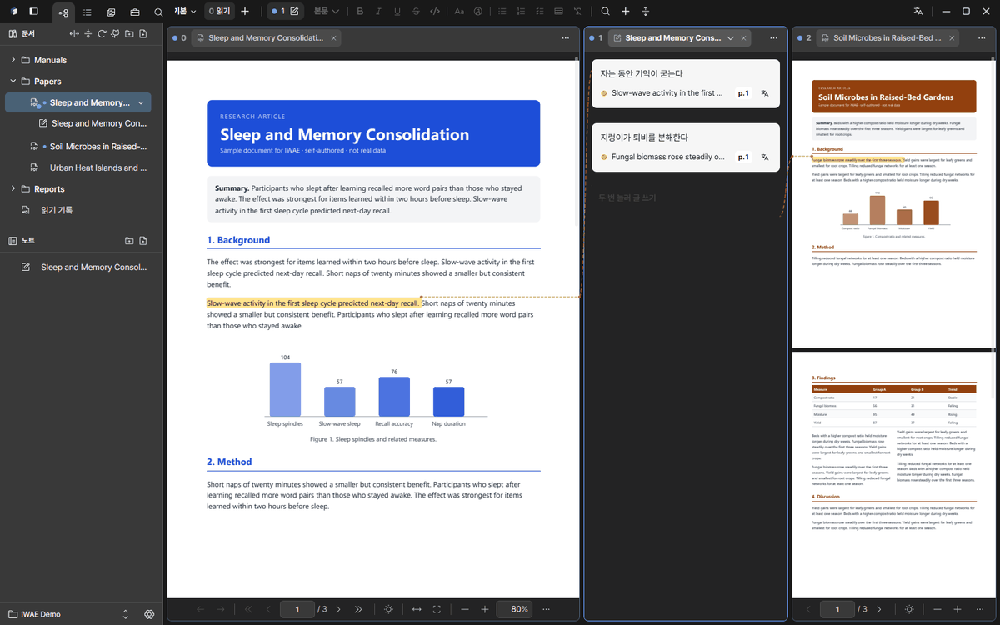
</p>

## 빠른 시작

1. [설치](#설치)하고 실행합니다. **예시로 시작하기**를 고르면 예시 문서가 든 Vault가 만들어지고, **내 폴더 열기**로 내 폴더를 쓸 수도 있습니다(빈 폴더에도 예시를 넣어 줍니다).
2. 왼쪽 바에서 **IWAE 사용 설명서**를 엽니다. 따라 하며 배우는 튜토리얼 PDF입니다. 장마다 「해 보기」 상자가 있어, 그 PDF 위에서 문장을 칠하고, 그림을 캡처하고, 문단을 번역해 봅니다.
3. 「노트」의 **IWAE 둘러보기**를 열고 메모 카드를 눌러 보세요. PDF가 그 메모를 단 문장으로 갑니다. 그다음 내 메모를 하나 더해 보세요.

설명서([한국어 PDF](public/sample-vault/iwae-manual.pdf), [English PDF](public/sample-vault/iwae-manual.en.pdf))는 12쪽이고, 첫머리에 「한 쪽 요약」이 있습니다.

## 기능

### Vault 정리하기

- Vault의 폴더 목록: PDF·Markdown이 실제 폴더 구조대로 보이고, 새 폴더·이름 바꾸기·옮기기·새로고침·끌어서 가져오기를 합니다.
- 다른 Vault로 바꿔 열 수 있고, 닫을 때 열어 둔 쪽과 탭이 다음 실행에 돌아옵니다.
- **라이브러리 보기**: 모든 문서를 제목·저자·연도 같은 논문 정보와 함께 표로 봅니다. 그 자리에서 고치고, 정렬하고, 별표를 달고, 모음으로 묶습니다. 논문 정보는 PDF 나 Crossref에서 채우고, BibTeX 인용 정보를 복사할 수 있습니다.
- **버전 묶기**: 같은 문서의 초안·수정본·최종본을 묶어 오갑니다.
- **GitHub에서 가져오기**: Markdown 문서 폴더를 가져오고, 새 커밋이 있으면 알려 줍니다.

<p align="center">
  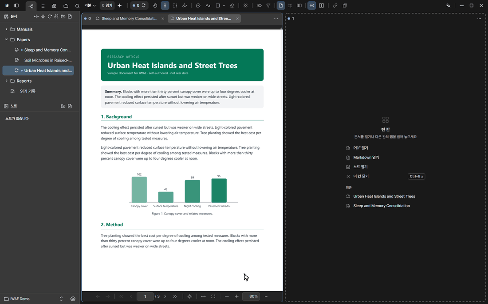
</p>

<!-- 영상 필요: docs/images/versions.ko.gif -->

### 나란히 읽기

- 연 문서마다 탭이 생기고, 탭은 **칸**에 모입니다. 칸은 tmux처럼 나눕니다. 접두키(기본 `Ctrl+B`) 다음에 `%` `"`로 나누고, 방향키로 이동하고, `z`로 크게 보고, `x`로 닫습니다. 칸 머리의 「⋯」 메뉴와 명령 팔레트(`Ctrl+K`)로도 같은 일을 합니다.
- **화면**은 칸을 모아 둔 한 장입니다(템플릿: 읽기, 노트 왼쪽, 비교). **세션**은 화면 여러 개를 이름 붙여 저장한 것이고, **떠 있는 칸**은 화면 위에 띄웁니다.
- 탭은 브라우저 탭처럼 끕니다. 순서 바꾸기, 다른 칸으로 옮기기, **칸 가장자리에 놓아 나누기**, **창 밖으로 끌어 새 앱 창으로 떼어 내기**가 됩니다. 칸 머리를 끌면 칸의 자리를 바꾸거나 옮깁니다.
- 칸 머리의 색 점은 **색 채널**입니다. 같은 색 칸끼리 연동해서, 문서 칸의 형광펜과 이웃한 노트 칸의 메모가 선으로 이어집니다.
- **새 창**(`Ctrl+Shift+N`): 같은 세션에 붙는 두 번째 앱 창. 변경은 동기화되고, 서로 덮어쓰지 않고 합쳐집니다.
- 한 쪽·두 쪽·세 쪽 보기, 연속 보기, 폭·쪽 맞춤, 쪽 회전, 어두운 화면용 색 반전. 같은 PDF의 다른 쪽을 나란히 보는 나누기도 있습니다.
- 링크나 `Table 5`, `Section 3.2` 같은 참조에 마우스를 올리면 미리 보고, 누르면 이동하며, 마우스 뒤로 단추로 돌아옵니다.

<p align="center">
  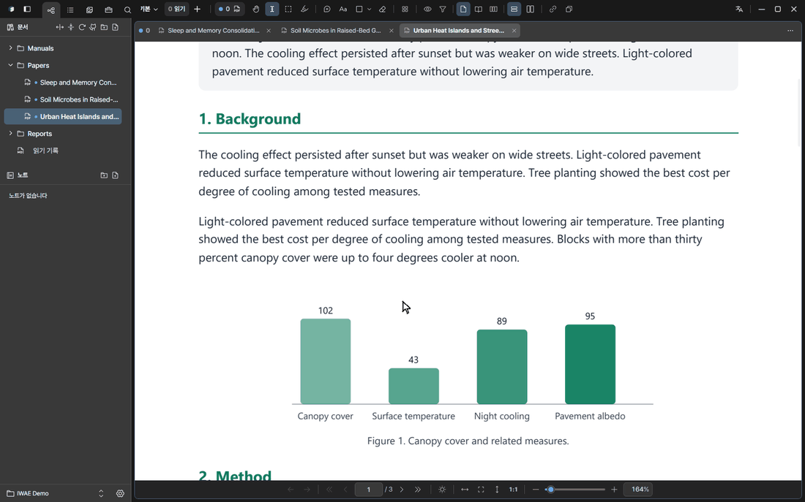
</p>

### 칠하고, 메모하고, 돌아오기

글을 고르면 노트에 메모가 열립니다. 메모는 형광펜과 연결선으로 이어지고, 선은 칸을 가로질러 가며 형광펜과 같은 색입니다. 메모를 누르면 PDF가 그 자리로 돌아갑니다.

<p align="center">
  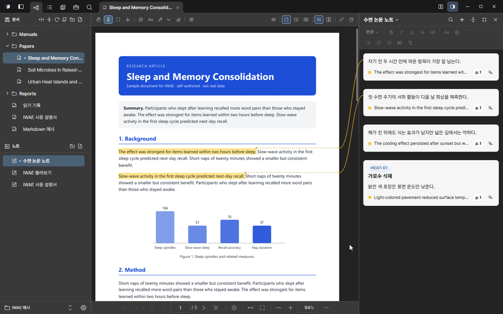
</p>

| 도구 | 하는 일 |
| --- | --- |
| 텍스트 선택 | 글을 칠하고 노트에 그 메모를 엽니다. |
| 영역 캡처 | 표나 그림을 네모로 감싸 노트에 그림으로 넣고, 나중에 크기를 고칩니다. |
| 형광펜 | 메모 없이 이름 붙인 내 색(최대 8가지)으로 칠합니다. |
| 박스 메모 | 쪽 여백에 메모 상자를 달고 선으로 잇습니다. |
| 글 상자·펜·선·화살표·도형·지우개 | 쪽 위에 직접 쓰고 그립니다. 지우개로 형광펜과 박스 메모도 지웁니다. |

그래프나 표를 네모로 감싸면 그림으로 노트에 들어가고, 설명을 붙일 수 있습니다.

<p align="center">
  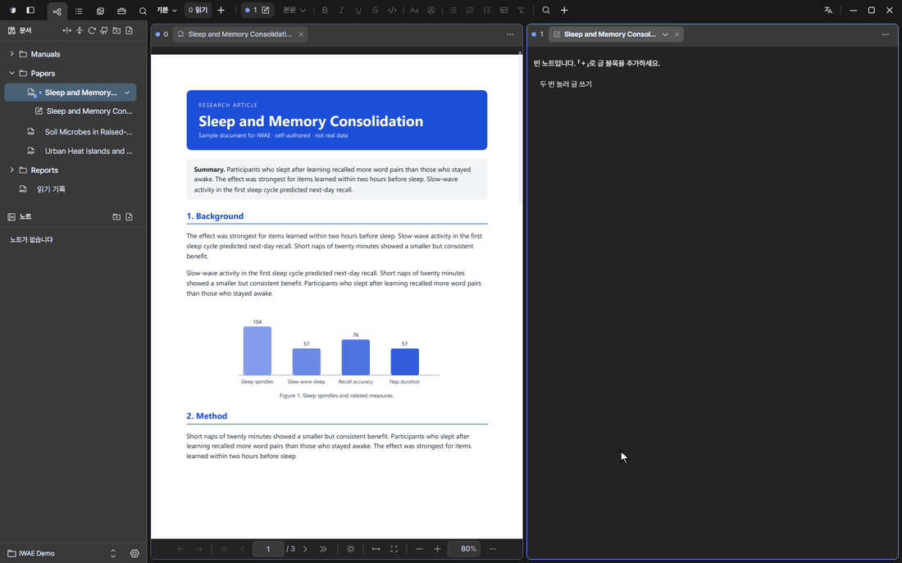
</p>

### 원문과 이어진 노트

노트는 블록으로 이루어지고, 한 노트에 여러 PDF·Markdown의 메모를 섞을 수 있습니다. 노트도 탭이라 자기 칸에서 따로 스크롤되고, 자기만의 확대 배율이 있습니다. 메모 블록은 다른 노트로 끌어 옮길 수 있고, `Alt`를 누른 채 놓으면 링크됩니다. `Ctrl+Shift+M`은 문서 옆 칸에 노트를 열고 닫습니다.

- **메모**: 내 글 아래에 출처가 붙습니다. 출처를 누르면 그 자리로 갑니다. 메모 하나에 출처를 여럿(영역 캡처 포함) 붙일 수 있습니다.
- **ID·제목(티켓)**: 어떤 메모에든 `REQ-01` 같은 자유 형식 ID와 제목을 붙입니다. 요구사항을 챙길 때 편합니다. 다음 번호를 제안하고, 노트에 이미 있는 ID면 알려 줍니다. 메모 맨 앞에 ID를 치면 ID 배지로 바뀝니다.
- **소제목**은 아래 블록을 묶고, 접거나 한꺼번에 끌어 옮깁니다. **글**은 굵게·목록·표·코드를 쓰는 자유 글입니다.
- 블록 여러 개를 골라(Ctrl·Shift+클릭) 한꺼번에 끌어 옮깁니다.
- **PDF마다 노트**: PDF마다 자기 노트를 두고, 왼쪽 바의 그 PDF 아래에 보이며, 노트 탭 제목에서 노트를 바꿉니다.
- **넓게 보기**: 노트 칸을 넓게 끌면 목차가 있는 넓은 열로 바뀌어 정리하고 다듬기 좋습니다.

<p align="center">
  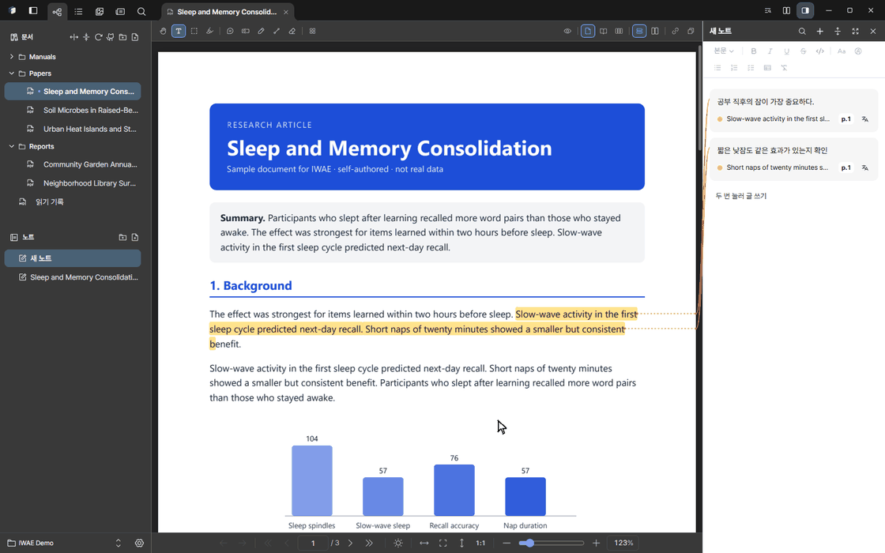
</p>

### 왼쪽 바: 탐색기·목록·미리보기·PDF 도구·검색

- **탐색기**: Vault의 문서와 노트.
- **목록**: 목차와 내 책갈피.
- **미리보기**: 쪽 썸네일. 지금 보이는 영역이 사각형으로 표시됩니다.
- **PDF 도구**: 그 자리에서 펼쳐 쓰는 도구 모음(아래).
- **검색**: 「이 문서」와 「모든 문서」. 파일 이름·폴더·PDF 본문·Markdown 내용을 한곳에서 찾고, 결과를 누르면 그 자리에서 열립니다. 글자 층이 없는 쪽은 함께 든 PaddleOCR 모델로 PC 안에서 읽고, 결과는 파일마다 저장합니다.

<p align="center">
  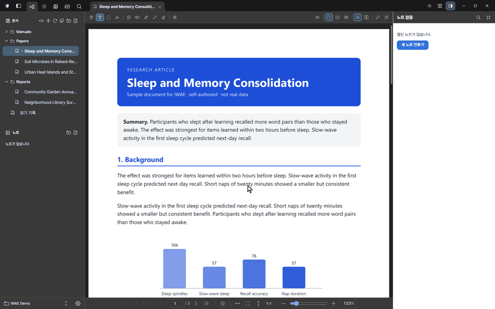
</p>

왼쪽 바, 노트 칸, 라이브러리는 Ctrl+휠로 각각 따로 확대합니다(80~150%).

### PDF 도구

모두 내 PC 안에서 돌아갑니다. 대부분 원본에 적용하거나 사본으로 만들 수 있습니다.

| 묶음 | 도구 |
| --- | --- |
| 글자 | OCR (스캔 글자 인식), 두 버전의 글자 비교 |
| 주석 | PDF 안의 기존 주석 가져오기, 형광펜·메모·그림을 쪽에 구워 넣은 PDF 저장, 가린 곳의 글자를 정말 지운 PDF 저장 |
| 쪽 | 쪽 편집(순서·회전·삭제·다른 PDF의 쪽 끼우기. 형광펜은 자기 쪽을 따라가고 원본은 먼저 백업), 쪽 추출, PDF 분할 (목차별), PDF 병합, 빈 쪽 삭제, 눕거나 뒤집힌 스캔 쪽 방향 자동 보정 |
| 모양 | 쪽 번호 넣기, 워터마크 넣기, 여백 자르기, 모아찍기 (한 장에 여러 쪽), PDF 압축 (용량 줄이기) |
| 내보내기 | 쪽을 PNG 이미지로, 본문을 Markdown으로, 암호 해제한 PDF 저장 |

<p align="center">
  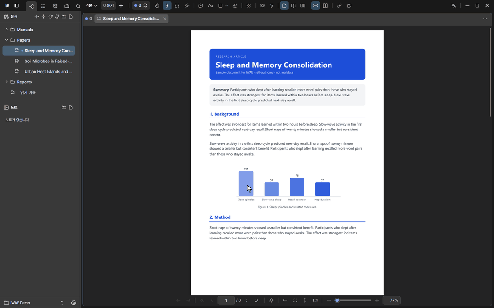
</p>

### 번역

원문은 바꾸지 않고 선택한 글을 번역합니다. 노트의 출처 줄마다 작은 번역 단추가 있고, 누르면 그 아래에 번역이 펼쳐집니다. **번역기**는 앱 창 위에 뜨는 패널이며, 맨 위 줄의 번역기 단추나 접두키 `w`로 열고 닫습니다.

<p align="center">
  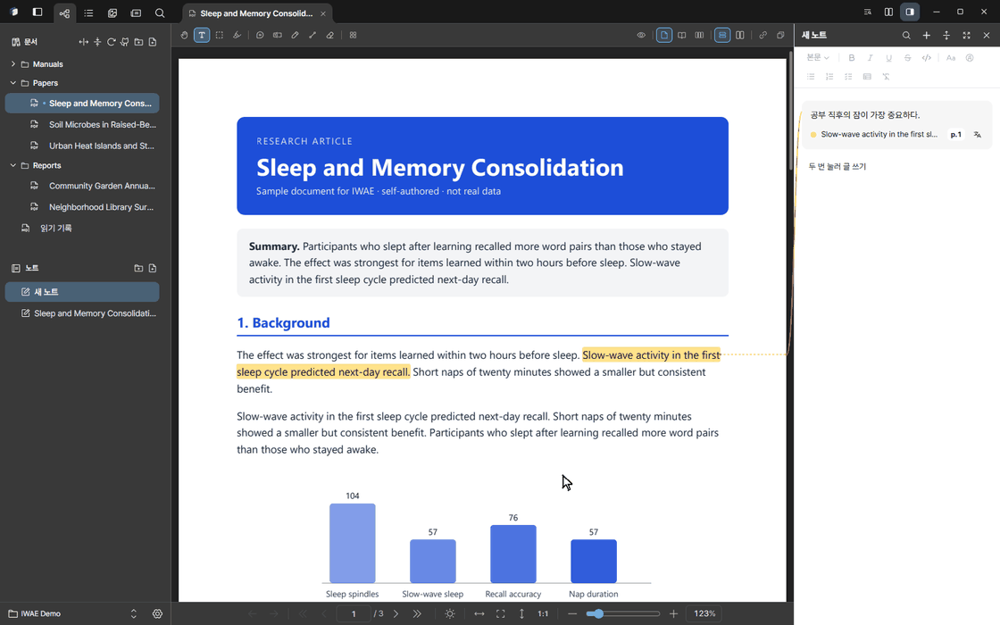
</p>

- **로컬:** 내 PC의 Ollama. 글이 PC 밖으로 나가지 않습니다.
- **클라우드:** Google 번역(키 없음), Azure Translator, DeepL, OpenAI, Anthropic, Gemini. 고른 서비스로 선택한 글이 보내집니다. API 키는 운영체제 자격 증명 저장소에 둡니다.
- **번역 캐시**: 한 번 번역한 글은 같은 언어로 다시 번역할 때 요청 없이 저장해 둔 결과를 씁니다. **설정 → 번역**에서 끄거나 지울 수 있습니다. 번역은 Vault의 `.iwae` 안에만 남습니다.

### Markdown

Markdown 파일도 PDF 옆 탭으로 열리고, 제목·표·코드·할 일 목록·목차를 보여 줍니다. 형광펜·메모·영역 캡처도 PDF와 똑같이 쓰고, 메모는 같은 노트에 들어갑니다.

<p align="center">
  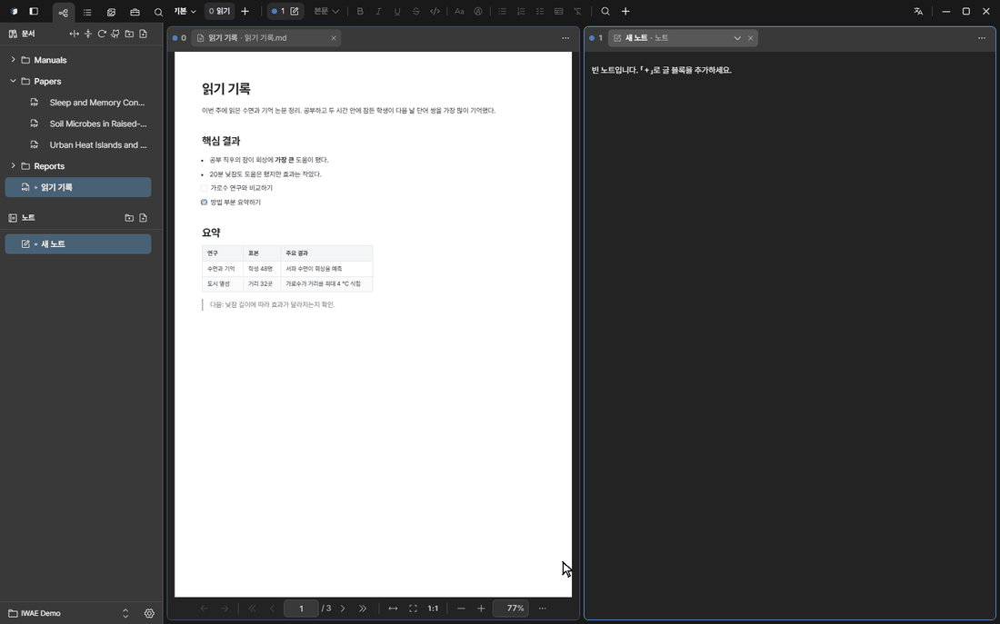
</p>

### 테마와 색

- 밝게·어둡게·시스템 따라가기, 기본 색 구성 네 가지.
- 원하는 강조색을 아무거나 고르고, 대비를 확인합니다.
- **내 테마**: 밝기마다 기본 색 8개만 정하면 나머지가 자동으로 정해지고, 미리보기와 대비 경고가 있는 편집기로 다듬고, 파일로 내보내고 가져옵니다.
- **내 형광펜 색**: 이름 붙인 색을 최대 8가지.
- 화면 크기, 한국어·English, Markdown 문서 테마 여섯 가지.

<p align="center">
  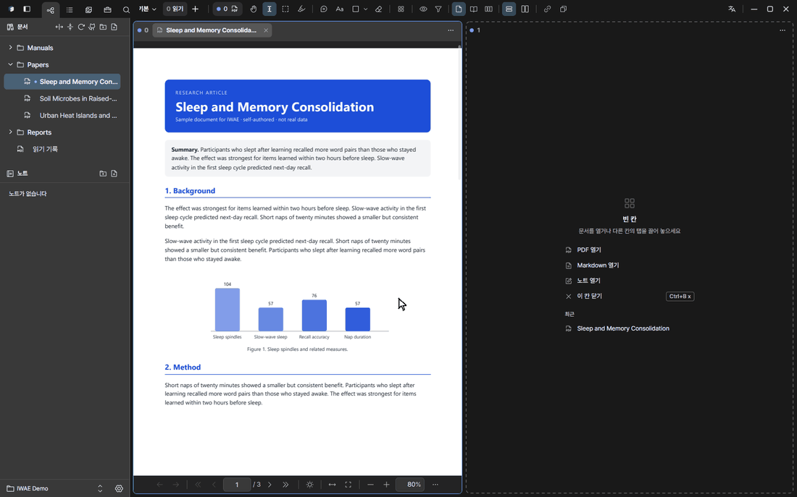
</p>

### 안전하게

- 형광펜·그림·메모 노트의 되돌리기·다시 하기. 다른 창에서 더한 내용은 건드리지 않습니다.
- 임시 파일과 기록(journal)을 쓰는 저장, 예전 상태 보관, 충돌한 수정 두 개 보관, 휴지통.
- 정한 주기에 Vault 전체를 zip으로 묶는 자동 백업.
- 업데이트는 확인하고 서명을 검사한 뒤, 사용자가 확인해야 설치합니다.

### AI 에이전트와 함께 쓰기

IWAE 안에는 채팅이 없습니다. 대신 바깥 에이전트(예: Claude Code)가 내 PC의 [MCP](https://modelcontextprotocol.io) 서버로 Vault를 다룰 수 있습니다.

1. **설정 → 외부 AI 연결**에서 켭니다. 처음에는 꺼져 있습니다.
2. 거기 보이는 명령을 한 번 실행합니다. 예:

   ```bash
   claude mcp add --transport http iwae http://127.0.0.1:47821/mcp --header "Authorization: Bearer <token>"
   ```

에이전트는 Vault를 검색하고(`search_vault`), 쪽을 글이나 그림으로 읽고(`read_page`, `page_image`), 위치를 보여 주고(`show_location`), 메모와 노트를 더하거나 고치거나 지울 수 있습니다(`memo_*`, `note_*`). PDF 파일은 바꾸지 못합니다. 서버는 `127.0.0.1` 에서만 듣고, 토큰이 있어야 하며, 웹 브라우저에서 온 요청은 거절합니다.

## 단축키

macOS에서는 `Ctrl` 대신 `⌘`를 씁니다. 전체 목록은 **설정 → 단축키·마우스**에 있습니다.

| 키 | 동작 |
| --- | --- |
| `Ctrl+Shift+P` / `Ctrl+K` | 명령 팔레트(명령·PDF 도구·문서) |
| `Ctrl+B` | 접두키. 다음 키: `%` `"` 나누기, 방향키 이동, `z` 크게, `x` 닫기, `c` 새 화면, `n` `p` 화면 이동, `f` 떠 있는 칸, `w` 번역기, `?` 키 목록 |
| `Ctrl+Shift+N` | 새 창 |
| `Ctrl+,` | 설정 |
| `Ctrl+F` / `Ctrl+Shift+F` | 이 문서에서 찾기 / 모든 문서에서 찾기 |
| `Ctrl+Shift+L` | 라이브러리 펼치기·접기 |
| `Ctrl+Tab` / `Ctrl+W` | 다음 탭 / 탭 닫기 |
| `Ctrl+Shift+M` | 문서 옆에 노트 열기·닫기 |
| `Ctrl+\` | 칸 수 바꾸기(1·2·3) |
| `Ctrl+G` | 쪽으로 가기 |
| `Alt+←` / `Alt+→` | 문서 점프 뒤로 / 앞으로 (마우스 뒤로·앞으로 단추도) |
| `Ctrl+Z` / `Ctrl+Shift+Z` | 되돌리기 / 다시 하기 |
| `T` `P` `L` `A` `R` `O` `X` `E` | 글 상자·펜·선·화살표·네모·동그라미·가리기·지우개 (`Esc`로 도구 끄기) |
| 오른쪽 단추를 누른 채 끌기 | 마우스 제스처: ↓ 맨 아래, ↑ 맨 위, ← 뒤로, → 앞으로, ㄴ 탭 닫기, ㄱ 닫은 탭 다시 열기 |

## 내 데이터와 개인정보

```text
내-vault/
├── *.pdf, *.md       내 문서 (바꾸지 않음)
├── 노트/*.iwnote      노트
└── .iwae/            형광펜·책갈피·색인·번역 캐시·세션·이력·휴지통
```

- IWAE는 로컬 우선입니다. 문서·형광펜·노트·검색 색인·번역 캐시가 모두 Vault 폴더에 있어서, 어떤 도구로든 복사·백업·동기화할 수 있습니다.
- **PC 밖으로 나갈 수 있는 것**: 내가 고른 **클라우드** 번역 서비스에 보내는 선택한 글, 업데이트 확인, 그리고 내가 직접 연결을 켠 뒤의 외부 AI 에이전트 요청(`127.0.0.1` 에서만 듣습니다). 로컬 번역과 OCR은 PC 밖으로 나가지 않습니다.
- 클라우드 API 키는 Vault가 아니라 운영체제 자격 증명 저장소에 둡니다.

## 설치

설치 파일은 [Releases](https://github.com/radic2682/IWAE/releases)에 올라갑니다.

**Windows**

- `IWAE_<version>_x64-setup.exe`: 권장. 지금 사용자에게만 설치합니다.
- `IWAE_<version>_x64_en-US.msi`: 여러 PC에 일괄 배포할 때.
- 설치 파일에 아직 코드 서명이 없어서, 처음 실행할 때 Windows SmartScreen이 「Windows의 PC 보호」 창을 띄울 수 있습니다. **추가 정보 → 실행**을 누르세요. 업데이트는 그래도 IWAE 자체 서명을 검사한 뒤에만 설치됩니다.

**macOS** (12 이상, Apple Silicon·Intel)

- 맥 설치 파일은 아직 올리지 않았고, 다음 릴리스에 함께 올릴 예정입니다. 그동안은 맥에서 [소스로 빌드](#소스에서-빌드)해 쓸 수 있습니다.
- 아직 Apple 공증을 받지 않아 처음 열 때 경고가 뜹니다. **시스템 설정 → 개인정보 보호 및 보안**에서 **그래도 열기**를 한 번 누르세요.

**업데이트:** 배포 버전은 업데이트를 확인하고, 서명을 검사한 뒤, 사용자가 확인해야 설치합니다. **설정 → 업데이트**에서 자동 확인과 미리 내려받기를 정합니다.

## 소스에서 빌드

Node.js 22 이상, Rust stable, [Tauri 2 준비물](https://v2.tauri.app/start/prerequisites/)(Windows는 Microsoft C++ Build Tools와 WebView2)이 필요합니다.

```bash
git clone https://github.com/radic2682/IWAE.git
cd IWAE
npm ci
npm run tauri dev
```

`npm run dev`는 브라우저에서 화면만 미리 봅니다. 파일 열기·PDF 그리기 같은 데스크톱 기능은 Tauri 앱에서만 됩니다.

| 명령 | 용도 |
| --- | --- |
| `npm run tauri dev` | 개발 모드로 데스크톱 앱 실행 |
| `npm test` | 단위 테스트 (Vitest) |
| `npm run typecheck` | TypeScript 타입 검사 |
| `npm run build` | 타입 검사 후 프런트엔드 빌드 |
| `npm run test:e2e` | 브라우저·화면 비교 테스트 (Playwright) |
| `cargo test --manifest-path src-tauri/Cargo.toml` | Rust 테스트 |
| `node scripts/build-sample-manual.mjs` | `docs/manual/`에서 `public/sample-vault/`의 튜토리얼 PDF를 다시 만듭니다(Edge 또는 Chrome 필요) |
| `npm run release:check` | 배포 준비물 검사 |
| `npm run release:build` | 설치 파일 빌드 |

배포 방법은 [영어 README](README.md#releasing-from-this-pc)에 있습니다. 릴리스 노트는 `docs/releases/`에 둡니다.

## 기술

| 층 | 기술 |
| --- | --- |
| 데스크톱 | Tauri 2, Rust |
| 화면 | React 19, TypeScript, Vite |
| PDF | PDFium (네이티브) |
| OCR | PaddleOCR.js, ONNX Runtime Web |
| 테스트 | Vitest, Testing Library, Playwright, Rust 테스트 |

```text
src/            화면 (앱, PDF 뷰어, 핵심 로직, 다국어, 스타일)
src-tauri/      네이티브 (저장, PDF, 번역, 검색 색인, MCP 서버)
scripts/        배포·설치 파일·OCR 검사, 튜토리얼 PDF 빌드
docs/manual/    튜토리얼 PDF 원본 (한국어·영어)
docs/releases/  릴리스 노트
```

## 기여

이슈와 범위가 분명한 PR을 환영합니다. PR 전에 돌릴 검사는 [CONTRIBUTING.md](CONTRIBUTING.md), 보안 문제 제보는 [SECURITY.md](SECURITY.md)를 보세요. 질문은 [Discussions](https://github.com/radic2682/IWAE/discussions)에, 자주 묻는 것은 [FAQ](docs/FAQ.ko.md)와 [로드맵](docs/ROADMAP.md)에 있습니다.

## 라이선스

MIT. 함께 든 외부 구성 요소와 자산은 [THIRD_PARTY_NOTICES.md](THIRD_PARTY_NOTICES.md)에 있습니다.
