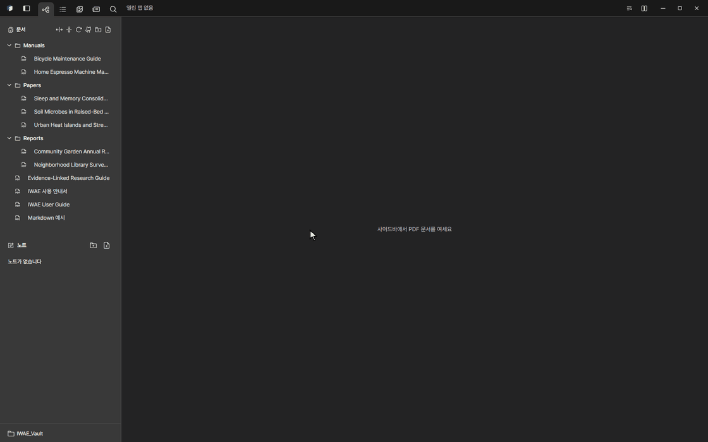

<p align="center">
  
</p>

<h1 align="center">IWAE</h1>

<p align="center">
  <strong>Interwoven Writing and Evidence</strong><br>
  PDF·Markdown 을 왼쪽 폴더에서 정리하고, 누르면 바로 탭으로 열어 나란히 읽고,<br>
  칠한 곳을 원문 위치와 이어진 노트로 엮는 데스크톱 앱
</p>

<p align="center">
  
  
  
  
  
</p>

<p align="center"><a href="README.md">English</a></p>

<p align="center">
  
</p>

> **상태:** 알파. 읽기·메모·노트·저장 기능은 동작하지만, 화면과 파일 형식은 바뀔 수 있습니다.

## 왜 IWAE 인가요

PDF 뷰어는 대개 파일을 하나씩 열 뿐이고, 정리는 탐색기에 맡깁니다. 문헌 관리 프로그램은 정리는 잘하지만 서지 정보를 요구하고, 파일을 자기 라이브러리 안에 가둡니다. IWAE 는 그 사이에 있습니다.

- **내 폴더가 곧 서재입니다.** 아무 폴더(**Vault**)나 열면, 안의 하위 폴더와 PDF 가 디스크에 있는 그대로 왼쪽에 나무 모양으로 보입니다. 거기서 바로 폴더를 만들고, 이름을 바꾸고, 끌어서 옮깁니다.
- **누르면 바로 읽습니다.** PDF 나 Markdown 을 누르면 탭으로 열립니다. 여러 개를 열어 두고 브라우저 탭처럼 오갑니다.
- **나란히 읽습니다.** 창을 좌우 2·3칸, 위아래 2칸, 2×2 로 나누고 탭을 칸 사이로 끌어 옮깁니다.
- **읽으면서 표시합니다.** 문장을 칠하고 옆에 메모를 남기면 오른쪽 **노트**에 모입니다. 메모는 원문의 바로 그 자리와 이어져 있어서, 누르면 PDF 가 그곳으로 갑니다.

문서는 평범한 폴더 안의 평범한 파일로 남습니다. IWAE 는 형광펜·책갈피·노트·색인 같은 자기 기록을 Vault 안 `.iwae` 폴더에 따로 둡니다. 그래서 폴더째 복사·백업·동기화하면 됩니다.

<p align="center">
  
</p>

## 기능

### 정리하고 읽기

- 왼쪽에 Vault 의 폴더 목록: PDF·Markdown 이 실제 폴더 구조대로 보이고, 새 폴더·이름 바꾸기·옮기기·새로고침을 합니다.
- 연 문서마다 탭이 생기고, 창을 좌우·위아래·격자로 나눕니다. 탭을 끌어 다른 칸으로 옮깁니다.
- 목차, 쪽 썸네일, 문서 안 검색(Ctrl+F), Vault 전체 문서 검색.
- 링크나 `Table 5`, `Section 3.2` 같은 참조에 마우스를 올리면 미리 보고, 누르면 이동합니다. 마우스 뒤로 단추로 돌아옵니다.
- 한 쪽 또는 두 쪽 보기, 쪽 회전, 어두운 화면용 색 반전, 밝은·어두운 앱 테마.
- 읽던 곳에서 다시 엽니다.
- **라이브러리 보기**: 모든 문서를 제목·저자·연도 같은 논문 정보와 함께 표로 봅니다. 그 자리에서 고치고, 정렬하고, 별표를 달고, 모음으로 묶습니다.
- **논문 정보**는 PDF 나 Crossref 에서 채우고, BibTeX 인용 정보를 복사할 수 있습니다.
- **버전 묶기**: 같은 문서의 여러 파일(초안·수정본·최종본)을 묶어 오갑니다.

### 표시하기

| 도구 | 하는 일 |
| --- | --- |
| 텍스트 선택 | 글을 칠하고 노트에 그 메모를 엽니다. |
| 영역 캡처 | 표나 그림을 네모로 감싸 노트에 그림으로 넣습니다. |
| 형광펜 | 메모 없이 여러 색으로 칠합니다. |
| 박스 메모 | 쪽 여백에 메모 상자를 달고 선으로 잇습니다. |
| 글상자·펜·선·지우개 | 쪽 위에 바로 쓰고 그립니다. 지우개로 형광펜과 박스 메모도 지웁니다. |
| 페이지 편집 | 쪽 순서 바꾸기·회전·삭제, 다른 PDF 의 쪽 끼워 넣기. 형광펜은 자기 쪽을 따라가고, 원본은 먼저 백업합니다. |

글을 고르면 노트에 메모가 바로 열립니다. 메모를 쓰고, 나중에 메모를 누르면 원문의 그 자리로 돌아갑니다.

<p align="center">
  
</p>

그래프나 표를 네모로 감싸면 그림으로 노트에 들어가고, 설명을 붙일 수 있습니다.

<p align="center">
  
</p>

### 노트

노트는 블록으로 이루어지고, 한 노트에 여러 PDF·Markdown 의 메모를 섞을 수 있습니다.

- **메모**: 내 글 아래에 출처가 붙습니다. 출처를 누르면 그 자리로 갑니다. 메모 하나에 출처를 여럿(영역 캡처 포함) 붙일 수 있습니다.
- **ID·제목**: 어떤 메모에든 `REQ-01` 같은 자유 형식 ID 와 제목을 붙입니다. 요구사항을 챙길 때 편합니다. 다음 번호를 제안하고, 노트에 이미 있는 ID 면 알려 줍니다. 메모 맨 앞에 ID 를 치면 ID 배지로 바뀝니다.
- **섹션**: 아래 블록을 묶습니다. 접거나 한꺼번에 끌어 옮깁니다.
- **텍스트**: 굵게·목록·표·코드를 쓰는 자유 글.
- 블록 여러 개를 골라(Ctrl·Shift+클릭) 한꺼번에 끌어 옮깁니다.

<p align="center">
  
</p>

### 번역

원문은 그대로 두고 선택한 글을 번역합니다. 노트의 출처 줄마다 작은 번역 단추가 있어서, 누르면 바로 아래에 번역이 펼쳐집니다.

<p align="center">
  
</p>

- **로컬:** 내 PC 의 Ollama. 글이 PC 밖으로 나가지 않습니다.
- **클라우드:** OpenAI, Anthropic, Gemini, Azure Translator, DeepL. 고른 서비스로 선택한 글이 보내집니다. API 키는 운영체제 자격 증명 저장소에 둡니다.
- **번역 캐시**: 한 번 번역한 글은 같은 언어로 다시 번역할 때 요청 없이 바로 꺼내 씁니다. **설정 → 번역**에서 끄거나 지울 수 있습니다. 번역은 Vault 의 `.iwae` 안에만 남습니다.

### Markdown

Markdown 파일도 PDF 옆 탭으로 열리고, 제목·표·코드·할 일 목록·목차를 보여 줍니다. 형광펜·메모·영역 캡처도 PDF 와 똑같이 씁니다.

<p align="center">
  
</p>

- **GitHub 에서 가져오기**: GitHub 저장소의 Markdown 문서 폴더를 가져옵니다. 새 커밋이 있으면 상단바에 알려 주고, 최신으로 받거나 브랜치·태그·커밋의 예전 판으로 바꿔 볼 수 있습니다.

### 검색과 OCR

- 파일 이름·폴더·PDF 본문·Markdown 내용을 한곳에서 찾습니다. 결과를 누르면 문서가 그 자리에서 열립니다.
- 글자 층이 없는 쪽은 함께 든 PaddleOCR 모델로 PC 안에서 읽습니다. 결과는 파일마다 저장해 두어, 바뀌지 않은 문서는 다시 읽지 않습니다.

<p align="center">
  
</p>

### AI 에이전트와 함께 쓰기

IWAE 안에는 채팅이 없습니다. 대신 바깥 에이전트(예: Claude Code)가 내 PC 의 [MCP](https://modelcontextprotocol.io) 서버로 Vault 를 다룰 수 있습니다.

1. **설정 → 외부 AI 연결**에서 켭니다. 처음에는 꺼져 있습니다.
2. 거기 보이는 명령을 한 번 실행합니다. 예:

   ```bash
   claude mcp add --transport http iwae http://127.0.0.1:47821/mcp --header "Authorization: Bearer <token>"
   ```

에이전트는 Vault 를 검색하고(`search_vault`), 쪽을 글이나 그림으로 읽고(`read_page`, `page_image`), 위치를 보여 주고(`show_location`), 메모와 노트를 더하거나 고치거나 지울 수 있습니다(`memo_*`, `note_*`). PDF 파일은 바꾸지 못합니다. 서버는 `127.0.0.1` 에서만 듣고, 토큰이 있어야 하며, 웹 브라우저에서 온 요청은 거절합니다.

## 저장 위치

```text
내-vault/
├── *.pdf, *.md       내 문서 (그대로 둠)
├── 노트/*.iwnote      노트
└── .iwae/            형광펜·책갈피·색인·이력·휴지통
```

- 저장은 임시 파일에 쓴 뒤 한 번에 바꿔 끼우고, 기록(journal)으로 중간에 끊긴 저장을 알아챕니다.
- 예전 판은 정해진 기간만큼 남기고, 충돌한 수정은 둘 다 남겨 고르게 합니다.
- 지운 항목은 먼저 `.iwae/trash/` 로 갑니다.

## 설치

설치 파일은 [Releases](https://github.com/radic2682/IWAE/releases) 에 올라갑니다.

**Windows**

- `IWAE_<version>_x64-setup.exe`: 권장. 지금 사용자에게만 설치합니다.
- `IWAE_<version>_x64_en-US.msi`: 여러 PC 에 일괄 배포할 때.

**macOS** (12 이상, Apple Silicon·Intel)

- `IWAE_<version>_universal.dmg`: 열어서 IWAE 를 응용 프로그램 폴더로 끌어 놓습니다.
- 아직 Apple 공증을 받지 않아 처음 열 때 경고가 뜹니다. **시스템 설정 → 개인정보 보호 및 보안**에서 **그래도 열기**를 한 번 누르세요.

배포판은 업데이트를 확인하고, 서명을 검사한 뒤, 사용자가 확인해야 설치합니다.

새 Vault 에는 **IWAE 사용 안내서** PDF([한국어](docs/manual/iwae-manual.html), [English](docs/manual/iwae-manual.en.html))와 그것으로 만든 예시 노트가 들어 있습니다. 읽으면서 직접 연습해 보세요.

## 소스에서 빌드

Node.js 22 이상, Rust stable, [Tauri 2 준비물](https://v2.tauri.app/start/prerequisites/)(Windows 는 Microsoft C++ Build Tools 와 WebView2)이 필요합니다.

```bash
git clone https://github.com/radic2682/IWAE.git
cd IWAE
npm ci
npm run tauri dev
```

`npm run dev` 는 브라우저에서 화면만 미리 봅니다. 파일 열기·PDF 그리기 같은 데스크톱 기능은 Tauri 앱에서만 됩니다.

| 명령 | 용도 |
| --- | --- |
| `npm run tauri dev` | 개발 모드로 데스크톱 앱 실행 |
| `npm test` | 단위 테스트 (Vitest) |
| `npm run typecheck` | TypeScript 타입 검사 |
| `npm run build` | 타입 검사 후 프런트엔드 빌드 |
| `npm run test:e2e` | 브라우저·화면 비교 테스트 (Playwright) |
| `cargo test --manifest-path src-tauri/Cargo.toml` | Rust 테스트 |
| `npm run release:check` | 배포 준비물 검사 |
| `npm run release:build` | 설치 파일 빌드 |

## 기술

| 층 | 기술 |
| --- | --- |
| 데스크톱 | Tauri 2, Rust |
| 화면 | React 19, TypeScript, Vite |
| PDF | PDFium (네이티브) |
| OCR | PaddleOCR.js, ONNX Runtime Web |
| 테스트 | Vitest, Testing Library, Playwright, Rust 테스트 |

```text
src/          화면 (앱, PDF 뷰어, 핵심 로직, 다국어, 스타일)
src-tauri/    네이티브 (저장, PDF, 번역, 검색 색인, MCP 서버)
scripts/      배포·설치 파일·OCR 검사
docs/manual/  사용 안내서 원본
```

## 기여

이슈와 범위가 분명한 PR 을 환영합니다. PR 전에 돌릴 검사는 [CONTRIBUTING.md](CONTRIBUTING.md), 보안 문제 제보는 [SECURITY.md](SECURITY.md) 를 보세요.

## 라이선스

MIT. 함께 든 외부 구성 요소와 자산은 [THIRD_PARTY_NOTICES.md](THIRD_PARTY_NOTICES.md) 에 있습니다.
