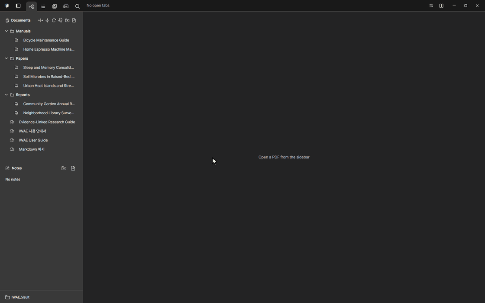
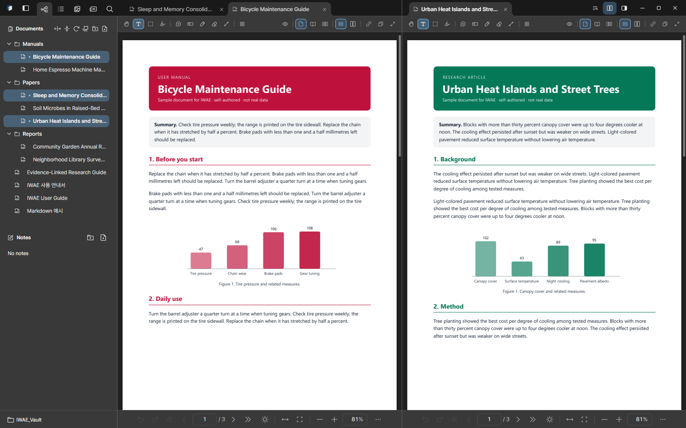
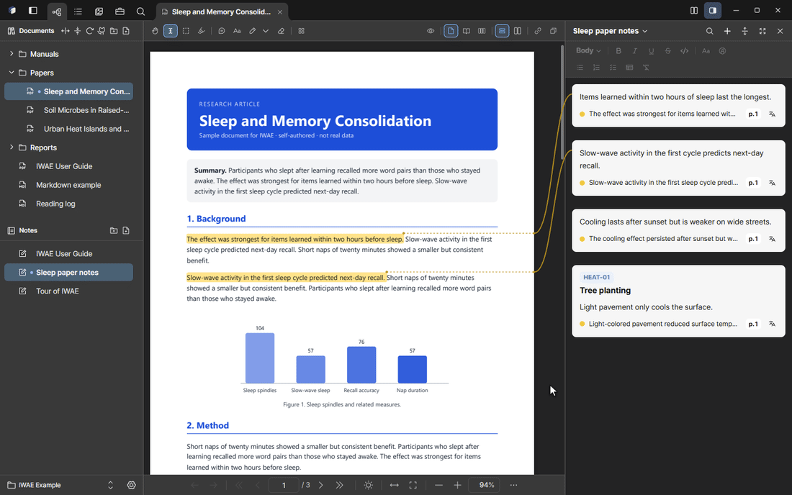
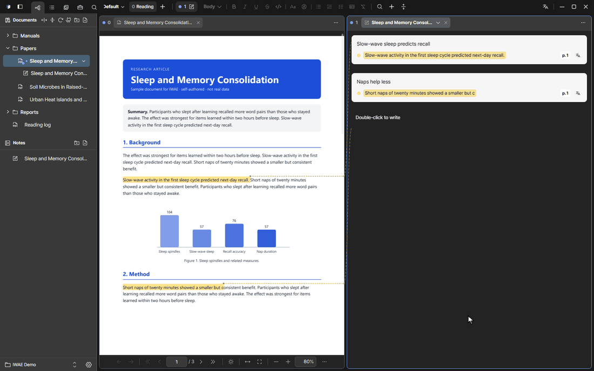
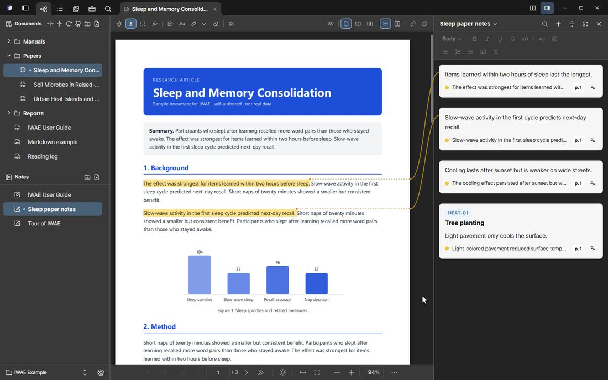
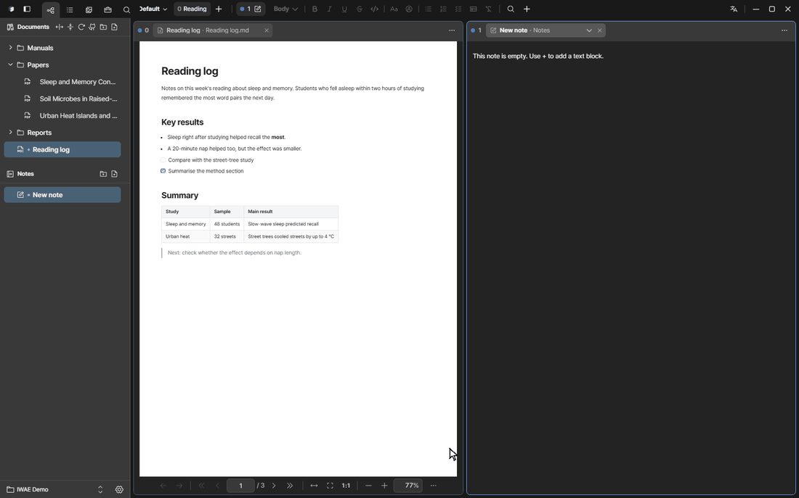
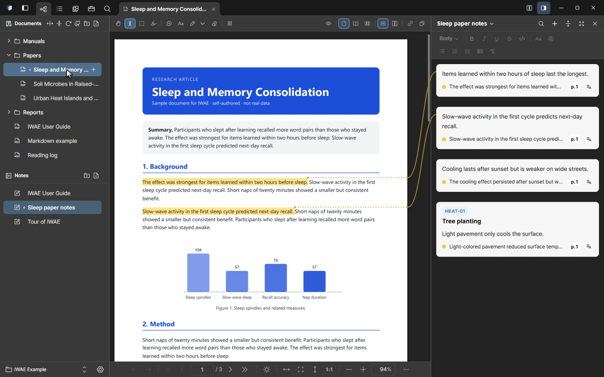

<p align="center">
  
</p>

<h1 align="center">IWAE</h1>

<p align="center">
  <strong>Interwoven Writing and Evidence</strong><br>
  Keep your PDFs and Markdown files in folders on the left, click to open them in tabs, read them side by side,<br>
  and turn your highlights into notes that always point back to the source.
</p>

<p align="center">
  
  
  
  
  
</p>

<p align="center"><a href="README.ko.md">한국어</a></p>

<p align="center">
  
</p>

> **Status:** alpha. The core reading, memo, note and storage features work, but the interface and file formats may still change.

## Why IWAE

Most PDF readers open one file at a time and leave the organizing to your file manager. Reference managers organize well, but they want metadata and keep your files inside their own library. IWAE sits in between:

- **Your folder is the library.** Open any folder (a **Vault**). Its subfolders and PDFs appear as a tree on the left, exactly as they are on disk. Create folders, rename, and drag files around right there.
- **One click to read.** Click a PDF or Markdown file and it opens in a tab. Open as many as you like and switch between them like browser tabs.
- **Read side by side.** Split the window into two or three columns, two rows, or a 2×2 grid, and drag tabs between the panes.
- **Mark up as you go.** Highlight a passage and write a memo next to it. Memos collect into **notes** on the right, and each memo stays linked to the exact spot it came from. Click it and the PDF jumps back there.

Your documents stay ordinary files in an ordinary folder. IWAE keeps its own records (highlights, bookmarks, notes, indexes) in a `.iwae` folder inside the Vault, so you can copy, back up or sync the whole thing with any tool.

<p align="center">
  
</p>

## Features

### Organizing and reading

- A folder tree of the Vault on the left: PDFs and Markdown files in their real folders, with new folder, rename, move and refresh.
- Tabs for every open document, and a window split into columns, rows or a grid. Drag a tab to move it to another pane.
- Outline, page thumbnails, in-document search (Ctrl+F) and a search across every document in the Vault.
- Hover a link or a reference such as `Table 5` or `Section 3.2` to preview it; click to jump, and go back with the mouse back button.
- Single page or two-page spreads, page rotation, dark-mode color inversion, light and dark app themes.
- Resumes where you left off.
- A **library view** lists every document in a table with its paper details (title, authors, year). Edit them in place, sort, star and group documents into collections.
- **Paper details** are filled from the PDF or Crossref, and you can copy a BibTeX citation.
- **Versions:** group several files of the same document (draft, revised, final) and switch between them.

### Marking up

| Tool | What it does |
| --- | --- |
| Text select | Highlight text and open a memo for it in the note. |
| Region capture | Box a table or figure and add it to the note as an image. |
| Highlighter | Paint passages in one of several colors without writing a memo. |
| Box memo | Attach a memo box in the page margin, connected by a line. |
| Text box, pen, line, eraser | Write and draw directly on the page. The eraser also removes highlights and box memos. |
| Edit pages | Reorder, rotate, remove, or insert pages from another PDF. Highlights follow the pages they belong to, and the original file is backed up first. |

Select text and a memo opens in the note right away. Write your comment, and click the memo later to jump back to the exact spot:

<p align="center">
  
</p>

Box a chart or table to add it to the note as an image, with your description:

<p align="center">
  
</p>

### Notes

A note is built from blocks, and one note can mix memos from several PDFs and Markdown files.

- **Memo** is your comment with its sources underneath; click a source to jump to it. A memo can hold several sources, including captured regions.
- **ID and title:** give any memo a free-form ID such as `REQ-01` and a title, which is handy for tracking requirements. IWAE suggests the next number and warns about an ID already used in the note. Type an ID at the start of a memo and it turns into the ID badge.
- **Section** groups the blocks under it; collapse it or drag it as one unit.
- **Text** is free writing with bold, lists, tables and code.
- Select several blocks (Ctrl+click or Shift+click) and drag them together.

<p align="center">
  
</p>

### Translation

Translate a selection without replacing the original text. Each source line in a note also has a small translate button that shows the translation right under it.

<p align="center">
  
</p>

- **Local:** Ollama on your own PC. Nothing leaves the machine.
- **Cloud:** OpenAI, Anthropic, Gemini, Azure Translator or DeepL. The selected text is sent to the service you choose. API keys are kept in the operating system's credential store.
- **Translation cache:** a text translated once into the same language is reused instantly, without another request. Turn it off or clear it in **Settings → Translation**. Translations stay in the Vault's `.iwae` folder.

### Markdown

Markdown files open in tabs next to your PDFs, with headings, tables, code, task lists and an outline. Highlights, memos and region captures work the same way as in a PDF.

<p align="center">
  
</p>

- **From GitHub:** import a folder of Markdown documents from a GitHub repository. The toolbar shows when there are new commits; pull the latest, or open an older version from a branch, tag or commit.

### Search and OCR

- Search file names, folders, PDF text and Markdown content from one place. Click a result and the document opens at that spot.
- Pages without a text layer are recognized locally with the bundled PaddleOCR models. Results are cached per file, so unchanged documents are not processed again.

<p align="center">
  
</p>

### Working with AI agents

IWAE has no built-in chat. Instead it lets an external agent (for example Claude Code) work with your Vault through a local [MCP](https://modelcontextprotocol.io) server.

1. Turn it on in **Settings → External AI connection**. It is off by default.
2. Run the command shown there once, for example:

   ```bash
   claude mcp add --transport http iwae http://127.0.0.1:47821/mcp --header "Authorization: Bearer <token>"
   ```

The agent can search the Vault (`search_vault`), read pages as text or as images (`read_page`, `page_image`), point you to a passage (`show_location`), and add, change or remove memos and notes (`memo_*`, `note_*`). It cannot modify your PDF files. The server listens on `127.0.0.1` only, requires the token, and rejects requests that come from a web browser.

## Where things are stored

```text
your-vault/
├── *.pdf, *.md       your documents, left as they are
├── 노트/*.iwnote      notes
└── .iwae/            highlights, bookmarks, indexes, history, trash
```

- Saves go through a temporary file and an atomic rename, with a journal to detect interrupted writes.
- Earlier versions are kept for a limited time, and conflicting edits are kept side by side for you to resolve.
- Deleted items go to `.iwae/trash/` first.

## Install

Installers are published on the [Releases](https://github.com/radic2682/IWAE/releases) page.

**Windows**

- `IWAE_<version>_x64-setup.exe`: recommended. Installs for the current user.
- `IWAE_<version>_x64_en-US.msi`: for managed deployment.

**macOS** (12 or newer, Apple silicon and Intel)

- `IWAE_<version>_universal.dmg`: open it and drag IWAE to Applications.
- The app is not notarized by Apple yet, so the first launch shows a warning. Open **System Settings → Privacy & Security** and click **Open Anyway** once.

Release builds check for updates, verify their signature, and install only after you confirm.

A new Vault includes the **IWAE User Guide** PDF ([English](docs/manual/iwae-manual.en.html), [한국어](docs/manual/iwae-manual.html)) and an example note made from it. Practise on it as you read.

## Build from source

You need Node.js 22 or newer, the Rust stable toolchain, and the [Tauri 2 prerequisites](https://v2.tauri.app/start/prerequisites/) (on Windows: Microsoft C++ Build Tools and WebView2).

```bash
git clone https://github.com/radic2682/IWAE.git
cd IWAE
npm ci
npm run tauri dev
```

`npm run dev` starts a browser-only preview of the interface. Opening files, rendering PDFs and other desktop features need the Tauri app.

| Command | Purpose |
| --- | --- |
| `npm run tauri dev` | Run the desktop app in development mode |
| `npm test` | Unit tests (Vitest) |
| `npm run typecheck` | TypeScript type check |
| `npm run build` | Type-check and build the frontend |
| `npm run test:e2e` | Browser and visual regression tests (Playwright) |
| `cargo test --manifest-path src-tauri/Cargo.toml` | Rust tests |
| `npm run release:check` | Check release prerequisites |
| `npm run release:build` | Build the installers |

## Technology

| Layer | Technology |
| --- | --- |
| Desktop shell | Tauri 2, Rust |
| Interface | React 19, TypeScript, Vite |
| PDF | PDFium (native) |
| OCR | PaddleOCR.js, ONNX Runtime Web |
| Tests | Vitest, Testing Library, Playwright, Rust tests |

```text
src/          interface (app, pdf viewer, core logic, i18n, styles)
src-tauri/    native side (storage, PDF, translation, search index, MCP server)
scripts/      release, installer and OCR checks
docs/manual/  user guide sources
```

## Contributing

Issues and focused pull requests are welcome. See [CONTRIBUTING.md](CONTRIBUTING.md) for the checks to run before a pull request, and [SECURITY.md](SECURITY.md) to report a vulnerability.

## License

MIT. Third-party components and bundled assets are listed in [THIRD_PARTY_NOTICES.md](THIRD_PARTY_NOTICES.md).
