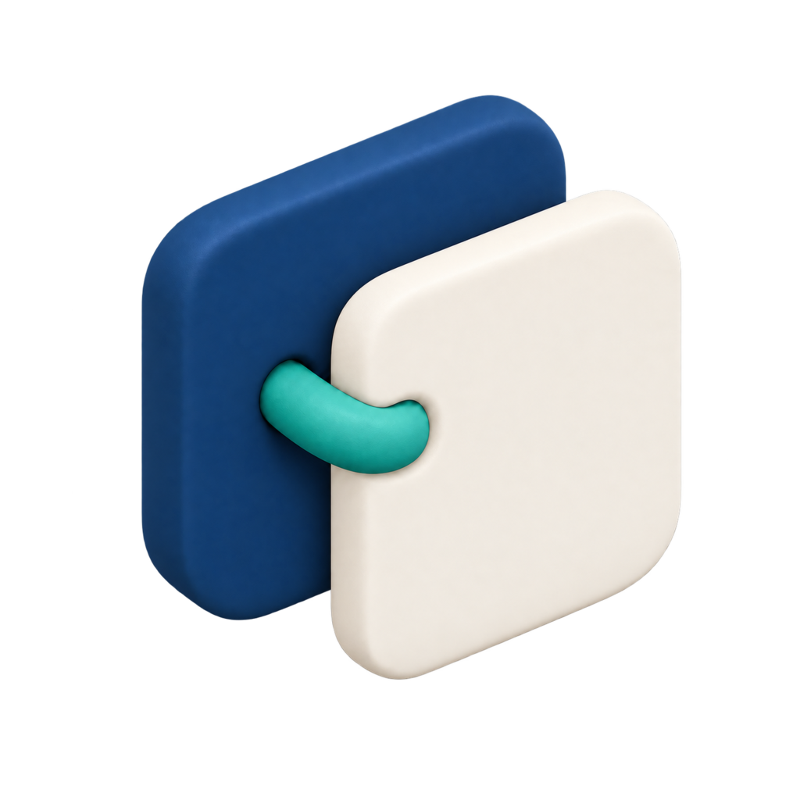
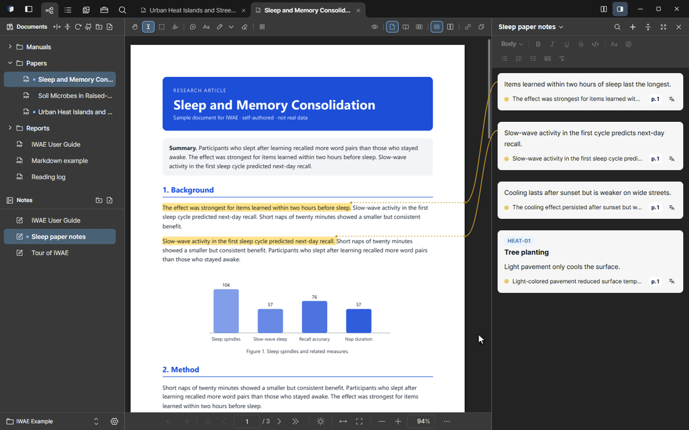
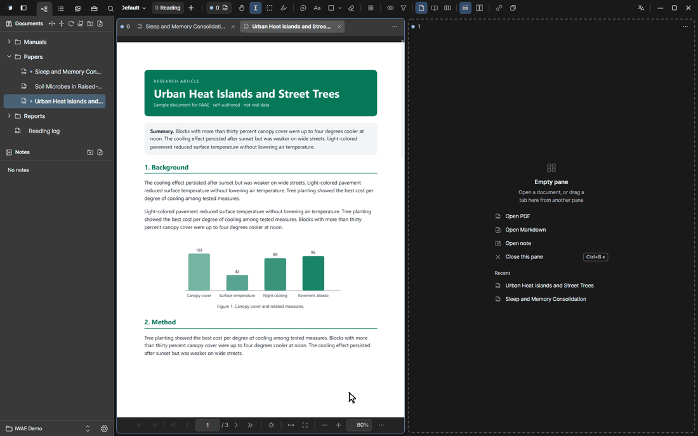
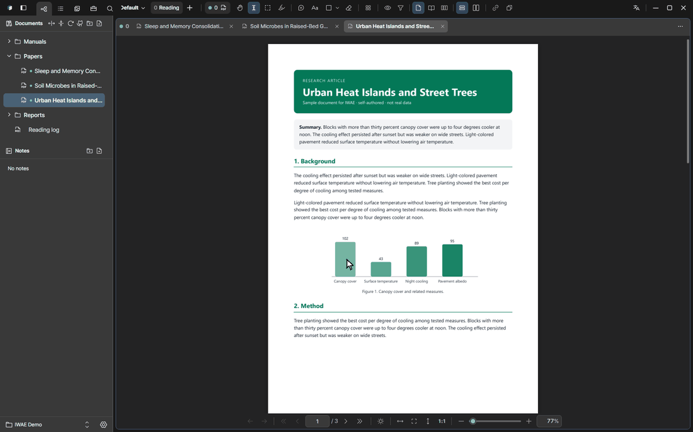
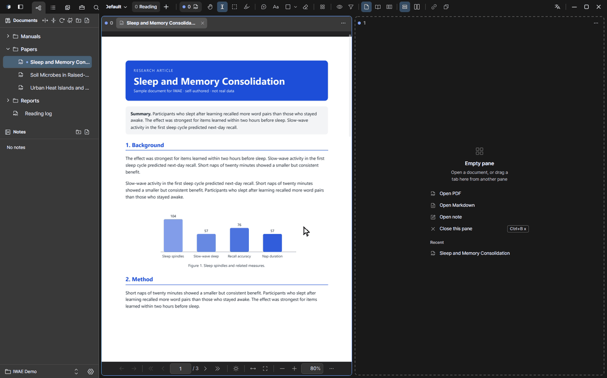

<p align="center">
  
</p>

<h1 align="center">IWAE: PDF notes woven to their source</h1>

<p align="center">
  <strong>Interwoven Writing and Evidence</strong><br>
  Read your PDFs, highlight what matters, and turn it into notes that always link back to the exact spot in the source.
</p>

<p align="center">
  
  
  
  
  
</p>

<p align="center"><a href="README.ko.md">한국어</a></p>

<p align="center">
  
</p>

> **Status:** alpha. Reading, memos, notes and storage work well, but the interface and file formats may still change.

## Why IWAE

Most PDF readers open one file at a time and leave the organizing to your file manager. Reference managers organize well, but they want metadata and keep your files in their own library. IWAE sits in between.

- **Your folder is the library.** Open any folder (a **Vault**) and its PDFs and Markdown files appear as they are on disk. Nothing is imported or locked in.
- **Highlight, and the memo is already there.** Select a sentence and a memo opens in the note on the right, joined to the highlight by a line. Click the memo later and the PDF jumps back to that exact sentence.
- **Read side by side.** Tabs, nine split layouts, windows you can pull a tab out into, and a note bar that stays put while you read.
- **Yours, and local.** Everything is stored in your Vault folder. Only text you choose to translate with a cloud service, or an external AI you connect yourself, ever leaves your PC.

<p align="center">
  
</p>

## Quick start

1. [Install IWAE](#install) and open it. Choose **Start with an example** to get a ready-made Vault in your Documents folder, or **Open my folder** to use your own (an empty folder gets the example too).
2. Open **IWAE User Guide** in the left bar. It is a hands-on tutorial PDF: every chapter ends with a “Try it” box that you do on that same PDF (highlight this sentence, capture this figure, translate this paragraph).
3. Open the **Tour of IWAE** note under “Notes” and click a memo card. The PDF jumps to the sentence it was written for. Then add a memo of your own.

The guide ([PDF](public/sample-vault/iwae-manual.en.pdf), [한국어 PDF](public/sample-vault/iwae-manual.pdf)) is 12 pages and starts with a one-page overview.

## Features

### Organize your Vault

- A folder tree of the Vault: PDFs and Markdown files in their real folders, with new folder, rename, move, refresh and drag-in import.
- Open several Vaults one at a time; the page and tabs you left open come back on the next start.
- **Library view:** a table of every document with paper details (title, authors, year) that you can edit in place, sort, star and group into collections. Details are filled from the PDF or Crossref, and you can copy a BibTeX citation.
- **Versions:** group the draft, revised and final files of one document and switch between them.
- **Import from GitHub:** bring in a folder of Markdown documents; the toolbar tells you when there are new commits.

<p align="center">
  
</p>

<!-- MEDIA TODO: docs/images/versions.gif -->

### Read side by side

- Tabs for every document. Drag them like browser tabs: reorder, move to another pane, **dock to a pane edge to split**, **drag out to detach a window**, drag back onto a tab bar to reattach.
- Nine split layouts for panes (two or three columns, two rows, 2×2 and mixed layouts), and a separate split that shows different pages of the same PDF.
- **New window** (`Ctrl+Shift+N`) for a second full window on the same Vault. Changes sync live and are merged, never overwritten.
- Single page, two- or three-page spreads, continuous scroll, fit width, fit page, rotation, dark-mode color inversion.
- Hover a link or a reference such as `Table 5` or `Section 3.2` to preview it; click to jump and go back with the mouse back button.

<p align="center">
  
</p>

### Highlight, memo, and jump back

Select text and a memo opens in the note right away. The memo is linked to its highlight by a connector line that crosses panes and takes the highlight's color. Click the memo and the PDF returns to the spot.

<p align="center">
  
</p>

| Tool | What it does |
| --- | --- |
| Select text | Highlight text and open a memo for it in the note. |
| Region capture | Box a table or figure and add it to the note as an image, resizable afterwards. |
| Highlight | Paint passages in your own named colors (up to eight) without writing a memo. |
| Box memo | Attach a memo box in the page margin, connected by a line. |
| Text box, pen, line, arrow, shapes, eraser | Write and draw directly on the page. The eraser also removes highlights and box memos. |

Box a chart or table to add it to the note as an image, with your description:

<p align="center">
  
</p>

### Notes that stay linked

A note is built from blocks, and one note can mix memos from several PDFs and Markdown files. The note bar is fixed at the right edge, scrolls on its own, and has its own zoom.

- **Memo:** your comment with its sources underneath; click a source to jump to it. A memo can hold several sources, including captured regions.
- **ID and title (tickets):** give any memo a free-form ID such as `REQ-01` and a title, which is handy for tracking requirements. IWAE suggests the next number and warns about an ID already used in the note. Type an ID at the start of a memo and it turns into the ID badge.
- **Section** groups the blocks under it; collapse it or drag it as one unit. **Text** is free writing with bold, lists, tables and code.
- Select several blocks (Ctrl+click or Shift+click) and drag them together.
- **A note per PDF:** each PDF can have its own notes, listed under it in the left bar, with a note switcher in the note bar title.
- **Memo-only view:** open the note as a wide column with an outline for organizing and polishing.

<p align="center">
  
</p>

### Left bar: explorer, outline, thumbnails, tools, search

- **Explorer:** documents and notes of the Vault.
- **Outline:** the table of contents and your bookmarks.
- **Thumbnails:** page previews with a rectangle showing what is on screen.
- **PDF tools:** a set of tools that unfold in place (below).
- **Search:** this document, or every document in the Vault. File names, folders, PDF text and Markdown content in one place; a result opens at the matching passage. Pages without a text layer are read locally with the bundled PaddleOCR models and cached per file.

<p align="center">
  
</p>

The left bar, the note bar and the library each zoom separately with Ctrl+wheel (80 to 150%).

### PDF tools

Everything runs on your PC. Most tools can apply to the original or write a copy.

| Group | Tools |
| --- | --- |
| Text | Add a text layer with OCR; compare the text of two versions |
| My marks | A copy with your highlights, memos and drawings flattened into the pages; a redacted copy that really removes the covered text |
| Pages | Edit pages (reorder, rotate, remove, insert from another PDF; highlights follow their pages and the original is backed up first); extract pages; split by chapters; merge PDFs; remove blank pages; fix sideways and upside-down scans |
| Layout | Page numbers, watermark, crop margins, N-up, compress |
| Export | Pages as PNG, text as Markdown, unlocked copy of a password-protected PDF |

<p align="center">
  
</p>

### Translation

Translate a selection without replacing the original text. Each source line in a note also has a small translate button that shows the translation right under it.

<p align="center">
  
</p>

- **Local:** Ollama on your own PC. Nothing leaves the machine.
- **Cloud:** OpenAI, Anthropic, Gemini, Azure Translator or DeepL. The selected text is sent to the service you choose. API keys are kept in the operating system's credential store.
- **Translation cache:** a text translated once into the same language is reused instantly, without another request. Turn it off or clear it in **Settings → Translation**. Translations stay in the Vault's `.iwae` folder.

### Markdown

Markdown files open in tabs next to your PDFs, with headings, tables, code, task lists and an outline. Highlights, memos and region captures work the same way as in a PDF, and the memos go into the same notes.

<p align="center">
  
</p>

### Themes and colors

- Light, dark or follow the system, with four built-in color schemes.
- Any accent color you like, with a contrast check.
- **Your own themes:** set eight base colors per brightness and the rest is derived; live editor with preview and contrast warnings; export and import themes as files.
- **Your own highlight colors:** up to eight named colors.
- Interface size, Korean or English, and six Markdown document themes.

<p align="center">
  
</p>

### Safe by design

- Undo and redo for highlights, drawings and memo notes, merged so another window's changes survive.
- Atomic saves with a journal, earlier states kept for a limited time, conflicting edits kept side by side, and a trash folder.
- Automatic backup of the whole Vault as a zip on the schedule you pick.
- Updates are checked, signature-verified, and installed only after you confirm.

### Working with AI agents

IWAE has no built-in chat. Instead it lets an external agent (for example Claude Code) work with your Vault through a local [MCP](https://modelcontextprotocol.io) server.

1. Turn it on in **Settings → External AI connection**. It is off by default.
2. Run the command shown there once, for example:

   ```bash
   claude mcp add --transport http iwae http://127.0.0.1:47821/mcp --header "Authorization: Bearer <token>"
   ```

The agent can search the Vault (`search_vault`), read pages as text or as images (`read_page`, `page_image`), point you to a passage (`show_location`), and add, change or remove memos and notes (`memo_*`, `note_*`). It cannot modify your PDF files. The server listens on `127.0.0.1` only, requires the token, and rejects requests that come from a web browser.

## Keyboard shortcuts

On macOS use `⌘` instead of `Ctrl`. The full list is in **Settings → Shortcuts & mouse**.

| Keys | Action |
| --- | --- |
| `Ctrl+Shift+P` | Command palette (commands, PDF tools and documents) |
| `Ctrl+Shift+N` | New window |
| `Ctrl+,` | Settings |
| `Ctrl+F` / `Ctrl+Shift+F` | Find in this document / search all documents |
| `Ctrl+Shift+L` | Expand or collapse the library |
| `Ctrl+Tab` / `Ctrl+W` | Next tab / close tab |
| `Ctrl+\` | Change the split view |
| `Ctrl+G` | Go to page |
| `Alt+←` / `Alt+→` | Back / forward through document jumps (also the mouse back and forward buttons) |
| `Ctrl+Z` / `Ctrl+Shift+Z` | Undo / redo |
| `T` `P` `L` `A` `R` `O` `X` `E` | Text box, pen, line, arrow, rectangle, ellipse, redact, eraser (`Esc` turns the tool off) |
| Right button + drag | Mouse gestures: ↓ bottom, ↑ top, ← back, → forward, ㄴ close tab, ㄱ reopen closed tab |

## Your data and privacy

```text
your-vault/
├── *.pdf, *.md       your documents, left as they are
├── Notes/*.iwnote     notes (Korean vaults use 노트/)
└── .iwae/            highlights, bookmarks, indexes, translation cache, history, trash
```

- IWAE is local-first. Documents, highlights, notes, search indexes and the translation cache live in your Vault folder. Copy, back up or sync it with any tool.
- **What can leave your PC:** the text you select when you translate with a **cloud** provider you chose, the update check, and requests from an external AI agent only after you turn that connection on yourself (it listens on `127.0.0.1` only). Local translation and OCR never leave the machine.
- Cloud API keys are kept in the operating system's credential store, not in the Vault.

## Install

Installers are published on the [Releases](https://github.com/radic2682/IWAE/releases) page.

**Windows**

- `IWAE_<version>_x64-setup.exe`: recommended. Installs for the current user.
- `IWAE_<version>_x64_en-US.msi`: for managed deployment.
- The installer is not code-signed yet, so Windows SmartScreen may say "Windows protected your PC" on the first run. Click **More info → Run anyway**. Every update is still verified with IWAE's own signature before it installs.

**macOS** (12 or newer, Apple silicon and Intel)

- A Mac installer is not published yet; it will come with a later release. Until then you can [build from source](#build-from-source) on a Mac.
- Builds are not notarized by Apple yet, so the first launch shows a warning. Open **System Settings → Privacy & Security** and click **Open Anyway** once.

**Updates:** release builds check for updates, verify the signature, and install only after you confirm. Settings → Updates controls automatic checks and pre-downloading.

## Build from source

You need Node.js 22 or newer, the Rust stable toolchain, and the [Tauri 2 prerequisites](https://v2.tauri.app/start/prerequisites/) (on Windows: Microsoft C++ Build Tools and WebView2).

```bash
git clone https://github.com/radic2682/IWAE.git
cd IWAE
npm ci
npm run tauri dev
```

`npm run dev` starts a browser-only preview of the interface. Opening files, rendering PDFs and other desktop features need the Tauri app.

| Command | Purpose |
| --- | --- |
| `npm run tauri dev` | Run the desktop app in development mode |
| `npm test` | Unit tests (Vitest) |
| `npm run typecheck` | TypeScript type check |
| `npm run build` | Type-check and build the frontend |
| `npm run test:e2e` | Browser and visual regression tests (Playwright) |
| `cargo test --manifest-path src-tauri/Cargo.toml` | Rust tests |
| `node scripts/build-sample-manual.mjs` | Rebuild the tutorial PDFs in `public/sample-vault/` from `docs/manual/` (needs Edge or Chrome) |
| `npm run release:check` | Check release prerequisites |
| `npm run release:build` | Build the installers |
| `npm run release:local` | Build, verify and publish a release from this PC (see below) |

### Releasing from this PC

Releases are built locally on Windows and uploaded with the GitHub CLI (the release workflow only runs manually).

1. Bump the version in `package.json`, commit, then tag and push: `git tag v<version>` and `git push origin v<version>`. The script never creates or pushes tags; the tag must point at HEAD and the working tree must be clean.
2. Put the signing secrets in `C:\Workspace\.iwae-release\release.env` (outside the repo; override the location with `IWAE_RELEASE_ENV`), one `KEY=VALUE` per line: `TAURI_SIGNING_PRIVATE_KEY` (or `TAURI_SIGNING_PRIVATE_KEY_PATH` pointing to a key file), `TAURI_SIGNING_PRIVATE_KEY_PASSWORD` (may be empty) and `IWAE_UPDATER_PUBLIC_KEY`. These are the same values stored as GitHub secrets. Values already set in the environment win, and secrets are never printed.
3. `npm run release:local -- --dry-run` shows the plan and what is missing. `npm run release:local` runs the tests, builds, verifies and collects everything into `dist-release/v<version>/` together with `latest.json`.
4. Add `--publish` to create the GitHub release (`--clobber` to overwrite an existing one). `--mac-dir <folder>` adds a Mac build (`*.dmg`, `*.app.tar.gz`, `*.app.tar.gz.sig`); without it the release is Windows-only and Mac users will not get the update.

Release notes live in `docs/releases/`.

## Technology

| Layer | Technology |
| --- | --- |
| Desktop shell | Tauri 2, Rust |
| Interface | React 19, TypeScript, Vite |
| PDF | PDFium (native) |
| OCR | PaddleOCR.js, ONNX Runtime Web |
| Tests | Vitest, Testing Library, Playwright, Rust tests |

```text
src/            interface (app, pdf viewer, core logic, i18n, styles)
src-tauri/      native side (storage, PDF, translation, search index, MCP server)
scripts/        release, installer, OCR checks and the tutorial PDF build
docs/manual/    tutorial PDF sources (Korean and English)
docs/releases/  release notes
```

## Contributing

Issues and focused pull requests are welcome. See [CONTRIBUTING.md](CONTRIBUTING.md) for the checks to run before a pull request, and [SECURITY.md](SECURITY.md) to report a vulnerability. Questions go to [Discussions](https://github.com/radic2682/IWAE/discussions); the [FAQ](docs/FAQ.md) and the [roadmap](docs/ROADMAP.md) answer the common ones.

## License

MIT. Third-party components and bundled assets are listed in [THIRD_PARTY_NOTICES.md](THIRD_PARTY_NOTICES.md).
