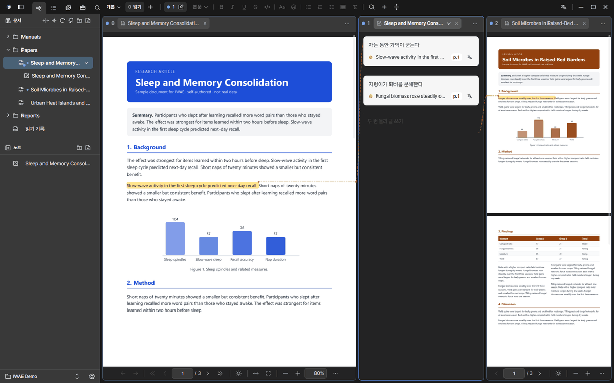

<!-- 기존 GitHub 릴리스 v0.1.10 의 본문(지금은 「Full Changelog」 링크 한 줄뿐)을 대신할 제안입니다. GitHub 릴리스는 직접 고치지 않았습니다. 마지막 줄의 Full Changelog 링크는 그대로 둡니다. -->

  

# IWAE v0.1.10

**창을 여러 개 띄워도 안전하고, 노트가 PDF 마다 따로 놓이는** 버전입니다.

## 새 기능

- **새 창** (`Ctrl+Shift+N`): 같은 Vault 를 보는 두 번째 전체 창. 모니터가 둘이면 한쪽에 문서, 한쪽에 노트를 둘 수 있습니다.
- **PDF 탭을 창으로 떼어 내기**: PDF 탭을 자기 창으로 보내고, 닫거나 「다시 붙이기」로 쪽과 배율 그대로 되돌립니다. 같은 문서를 두 번 떼어 내면 이미 있는 창이 앞으로 옵니다.
- **창이 여럿이어도 서로 덮어쓰지 않습니다**: 같은 Vault 에 동시에 쓰면 변경을 합치고, 한 창의 형광펜·메모·번역 캐시·책갈피 등이 다른 창에 바로 반영됩니다.
- **PDF 마다 노트**: 문서 행이 슬림해지고, 펼침 캐럿 하나로 그 PDF 의 노트가 아래에 보입니다. 오른쪽 바 제목에서 노트를 바꿉니다.
- **왼쪽 바·오른쪽 노트 바를 따로 확대**: `Ctrl`+휠로 각각 80~150%. 값은 앱에 저장되고 PDF 연결선은 카드에 그대로 붙어 있습니다.
- **메모만 보기 개편**: 노트 바와 같은 블록을 가운데 넓은 열에 놓고 왼쪽에 목차를 둡니다.
- **PDF 도구 두 가지**: 압축(큰 그림을 줄이고 실제로 작아질 때만 저장), 스캔 쪽 방향 바로잡기(옆으로 눕거나 뒤집힌 쪽을 OCR 로 알아내 바로 세움).
- **번역 결과 카드**: 언어·방식 표시, 다시 시도, 원문과 함께 복사가 있는 하나의 카드로 바뀌었습니다.

## 개선

- 되돌리기·다시 하기가 **합치는 방식**이 되었습니다. 예전에는 전체 목록을 되돌려 그 사이 다른 창이 더한 것까지 사라졌지만, 이제 되돌린 동작만 취소됩니다.
- 번역할 때 줄바꿈으로 끊긴 글을 이어 붙이고, 이미 번역할 언어인 글은 다른 언어로 번역합니다.
- 모서리 둥글기를 네 단계(4·6·8·12)와 알약 모양으로 통일했습니다.
- 노트 바와 서식 줄이 고정된 흰 종이가 아니라 앱 테마를 따릅니다. 어두운 화면에서 글 블록이 잘 읽힙니다.
- 선택 단추 글자가 가운데 정렬되고, 노트 블록 종류 목록에 앱 글꼴을 씁니다.
- 우클릭 메뉴를 열어도 고른 글이 칠해진 채 남습니다.

## 고친 것

- Vault 폴더에 둔 암호 PDF 가 목록에 오르지 않고 쪽 수가 틀리던 문제.
- 글자가 적은 PDF 의 글자 층이 버려지던 문제(쪽이 그림으로 가득 찬 경우만 버립니다).
- 줄바꿈 때문에 쪼개진 예전 번역 캐시가 남던 문제(자동으로 버립니다. 한 번 더 번역하면 됩니다).
- 목록을 확대할 때 왼쪽 바 머리글이 같이 커지던 문제, 영역 메모 그림이 노트 카드 밖으로 나가던 문제.
- 2×2 로 나눴을 때 노트 바가 둘로 보이던 문제.
- 빈 칸 탭 줄 글자가 세로 가운데에 오지 않던 문제.

## 업그레이드 안내

- 자동 업데이트로 설치됩니다. **설정 → 업데이트**를 확인하세요. Mac 은 Mac 빌드가 올라온 릴리스에서만 업데이트됩니다.
- 이 버전부터 여러 창이 같은 Vault 에 동시에 쓸 수 있습니다. 한 창에서 고친 내용이 다른 창에 합쳐지므로 같은 항목을 동시에 고치면 마지막 변경이 먼저 반영될 수 있습니다.
- 줄바꿈으로 쪼개진 번역 캐시는 정리되어 해당 글은 다음 번역 때 다시 요청합니다.

---

# IWAE v0.1.10 (English)

This release makes **several windows safe to use and gives each PDF its own notes**.

## New

- **New window** (`Ctrl+Shift+N`): a second full window on the same Vault. With two monitors, keep the document on one and the note on the other.
- **Detach a PDF tab into its own window**, and reattach it with its page and zoom by closing the window or using “Reattach”. Detaching the same document twice focuses the existing window.
- **Windows no longer overwrite each other:** simultaneous writes to the same Vault are merged, and highlights, memos, translation cache, bookmarks and more show up in the other window right away.
- **A note per PDF:** slimmer document rows with a single caret that shows that PDF's notes underneath, and a note switcher in the right bar title.
- **Zoom the left bar and the right note bar separately** with `Ctrl`+wheel, 80 to 150%, saved in app settings. PDF connector lines stay attached to the cards.
- **Memo-only view, redesigned:** the note bar's blocks in a wide centered column with an outline on the left.
- **Two PDF tools:** Compress (downsamples oversized images and only writes a file that is smaller) and Fix scanned page orientation (straightens sideways and upside-down pages using OCR).
- **Translation result card:** one card with language and provider chips, retry, and copy with original.

## Improved

- Undo and redo now **merge** instead of restoring the whole list: only the undone action is reverted, and anything another window added meanwhile survives.
- Text wrapped across lines is joined before translating, and text already in the target language is translated into another one.
- Corner radii are unified on a four-step scale (4, 6, 8, 12) plus full.
- The note bar and its format toolbar follow the app theme instead of a fixed white paper, and plain text blocks stay readable in dark.
- Labels on the selection toolbar are centered, and the note block-type dropdown uses the app font.
- A text selection stays highlighted while its right-click menu is open.

## Fixed

- Password-protected PDFs placed in the Vault folder were not registered and showed the wrong page count.
- The text layer of PDFs with little text was dropped (now only pages dominated by images lose it).
- Old cached translations split across lines lingered (they are dropped automatically; translate again once).
- Left bar section headers grew when zooming the list, and region memo images spilled out of the note card.
- A 2×2 split showed two note bars.
- The tab bar text in an empty pane was not vertically centered.

## Upgrade notes

- Installs through the automatic update; check **Settings → Updates**. macOS updates only from releases that include a Mac build.
- From this version several windows can write to the same Vault at once. Their changes are merged, so editing the very same item in two windows at the same time may keep only one of the edits.
- Cached translations that were split across lines are cleaned up, so those texts are requested again on the next translation.

**Full Changelog**: https://github.com/radic2682/IWAE/compare/v0.1.9...v0.1.10
