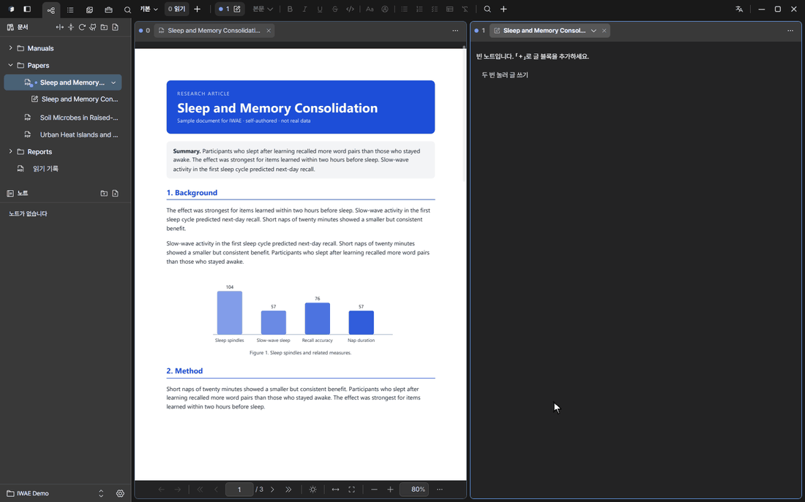
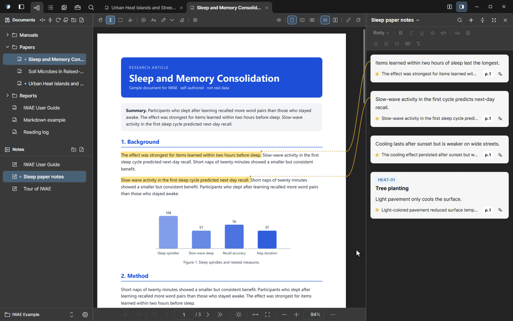

<!-- GitHub 릴리스 본문 초안(v0.1.11). 이미지는 릴리스 페이지에서 상대 경로가 안 되므로 raw 주소를 씁니다. hero.gif 는 새로 녹화한 뒤 저장소에 올려야 보입니다. -->

  

# IWAE v0.1.11 · 원문과 엮이는 PDF 노트

이번 버전은 **화면 구조를 다듬고, 내 색으로 꾸미고, 처음 쓰는 사람을 이끌어 주는** 업데이트입니다.

## 한눈에

- **라이브러리와 PDF 도구가 왼쪽 바로 들어왔습니다.** 라이브러리를 펼쳐도 왼쪽 바가 그대로 길잡이가 되고, PDF 도구는 그 자리에서 펼쳐 씁니다.
- **노트 바가 창 오른쪽 끝에 고정**되고, 연결선이 다른 칸을 가로질러 메모 카드에 닿습니다.
- **탭을 브라우저처럼 끕니다.** 순서 바꾸기, 칸 옮기기, 가장자리에 놓아 나누기, 창으로 떼어 내기, 다시 붙이기.
- **내 색으로 꾸밉니다.** 강조색을 아무거나 고르고, 나만의 테마를 만들어 파일로 나누고, 형광펜 색에 이름을 붙입니다.
- **새 튜토리얼 PDF.** 새 Vault 의 「IWAE 사용 설명서」가 따라 하며 배우는 12쪽 안내서로 바뀌었습니다.
- **PDF 를 열면 앱이 꺼지던 문제를 고쳤습니다.** 다른 뷰어에서 주석을 단 PDF 를 열어 둔 채 다시 켜면 앱이 바로 꺼질 수 있었습니다.

## 새 기능

- **내 테마와 강조색**: 강조색을 원하는 대로 고르면 밝은·어두운 화면에 맞는 색, 선택색, 글자색이 자동으로 정해지고 대비도 알려 줍니다. 밝기마다 기본 색 8개만 정하면 나머지 색이 정해지는 테마 편집기, 미리보기와 대비 경고, 파일로 내보내기·가져오기, 복제·삭제를 지원합니다.
- **형광펜 색 직접 만들기**: 이름 붙인 색을 최대 8가지까지 더하고 끌어서 순서를 바꿉니다. 지운 색으로 칠한 형광펜은 「기타」 색으로 남습니다.
- **탭 끌기**: 같은 칸에서 순서 바꾸기, 다른 칸의 탭 줄로 옮기기, 칸 가장자리에 놓아 새 칸 만들기, 창 밖으로 끌어 떼어 내기, 탭 줄에 끌어다 다시 붙이기.
- **라이브러리 펼치기 개편**: 왼쪽 바가 전체·즐겨찾기·최근 열람·폴더 탐색으로 바뀌고, 오른쪽은 제목·개수·검색 칸·목록/카드 전환이 있는 표만 보입니다. 라이브러리는 자기만의 확대 배율이 있습니다.
- **왼쪽 바 「PDF 도구」**: 도구가 아코디언처럼 자기 자리에서 펼쳐집니다. 쪽 편집만 PDF 칸을 차지합니다. 도구줄의 PDF 도구 단추는 없어졌습니다.
- **왼쪽 바 검색**: 「이 문서」와 「모든 문서」를 오갑니다. `Ctrl+Shift+F` 는 왼쪽 검색 탭을 모든 문서 범위로 엽니다.
- **미리보기에 보이는 영역 표시**: 쪽 썸네일 위에 지금 화면에 보이는 곳이 사각형으로 나타납니다.
- **새 튜토리얼 PDF와 예시 노트**: 장마다 「해 보기」가 있고, 연습 문장·표·그림이 들어 있습니다. 한 쪽짜리 「한눈에 보기」, 단축키 표, 쪽 번호와 PDF 목차(목록 탭)가 붙었습니다.
- **테마 파일(.iwtheme)**: 템플릿과 예시 테마를 제공하고, 파일을 창에 끌어 놓거나 두 번 눌러 바로 가져옵니다.
- **가져오기·내보내기**: 다른 PDF 뷰어에서 칠한 형광펜·메모를 가져오고, 노트를 Markdown 으로 내보내고, Zotero 에서 문서를 가져옵니다.
- **단축키 바꾸기**: 설정에서 단축키를 직접 바꾸고 한눈에 볼 수 있습니다. `Ctrl+=` / `Ctrl+-` / `Ctrl+0` 으로 문서를 확대·축소합니다.
- **번역 설정 카드와 문제 보고**: 번역 제공자마다 연결 확인 단추가 있고, 문제 보고 창은 경로를 가린 기록을 함께 담습니다.

## 개선

- 노트 바가 창 오른쪽 끝에 하나로 고정되고, 연결선이 칸을 가로질러 형광펜 색으로 이어집니다. 연결선은 「표시 모두 감추기」로 함께 숨습니다.
- 칸을 누르면 그 칸이 활성이 되고, 문서가 그 칸에 열립니다.
- 노트 바 열기·닫기, 화면 나누기 바꾸기, 탭 끌기에 짧은 움직임이 들어갔습니다.
- 메모 카드: 좌우 여백이 같아지고, 호버 색이 형광펜을 따르며, 탭이 카드에 붙고, 한국어가 띄어쓰기에서 줄바꿈됩니다. 마우스를 올린 카드의 탭이 위 카드를 가리지 않도록 블록 사이를 띄웠습니다.
- 빈 칸에 헤더 줄과 읽기 쉬운 안내가 생겼고, 연결선이 그 글자를 가로지르지 않습니다.
- 왼쪽 바: 선택된 문서·노트만 선택 표시를 하고 열린 항목은 점으로 보입니다. 탭을 바꿀 때 화면이 튀지 않습니다. 머리글·구분선·스크롤바가 모든 패널에서 나란히 맞습니다.
- 메모 메뉴의 「원문에서 보기」 이름을 알아보기 쉽게 바꿨습니다. 앱 메뉴의 「정보」는 맨 아래로 옮겼고, 앱 메뉴 밖 우클릭은 아무 일도 하지 않습니다.
- 모든 화면 색을 토큰으로 통일하고, 새 색 직접 지정이 들어오지 못하게 검사를 추가했습니다.
- 슬라이더가 테마 색을 따릅니다.
- 메뉴·대화상자·알림·아코디언·스위치·탭·노트 블록·연결선이 탄력 있게 움직입니다. 운영체제의 「움직임 줄이기」를 따릅니다.
- 키보드로 모든 곳을 오갈 수 있고 포커스 표시가 분명해졌습니다. 앱 안에서 브라우저 단축키(새로 고침·인쇄 등)가 눌리지 않습니다.
- 영어 화면: 새 영어 Vault 는 노트를 `Notes` 폴더에 두고, 기본 형광펜 색 이름과 테마 편집기가 영어로 보입니다.
- 큰 PDF: 색인 진행이 나뉘어 보이고, 검색이 빨라졌습니다. 쪽 표시는 화면에 가장 넓게 보이는 쪽을 따릅니다.
- 보안: 파일을 다루는 모든 명령이 허용된 폴더만 건드리고, 앱 화면은 앱 밖 주소로 이동하지 않으며, MCP 는 이 PC 에서 온 요청만 받습니다. PDFium 은 정해진 버전을 해시로 확인해 씁니다.

## 고친 것

- 왼쪽 바 탭을 바꿀 때 화면이 튀던 문제(라이브러리를 펼치고 접을 때만 움직입니다).
- 노트 바 옆에서 연결선이 부자연스럽게 꺾이던 문제(연결선 전용 여유 폭을 두었습니다).
- 노트 블록 사이에서 카드 탭이 위 카드를 가리던 문제.
- 주석이 있는 PDF 를 열면 앱이 꺼지던 문제.
- 번역이 실패하면 오류 페이지가 메모 카드에 그대로 들어가던 문제(짧은 안내로 바뀝니다).
- 탭을 아래쪽 칸에 붙이면 노트 열 위쪽이 비던 문제.
- 노트 블록 사이를 누르면 빈 블록이 저장되던 문제.
- PDF 옆 빈 곳을 한 번 누르면 책갈피 핀이 생기던 문제(이제 두 번 눌러야 합니다).
- 앱 밖에서 지운 PDF 가 라이브러리에 남던 문제, 밖에서 바뀐 파일이 늦게 반영되던 문제.

## 업그레이드 안내

- 앱의 업데이트 확인이 새 버전을 알려 주면 **설정 → 업데이트**에서 그대로 설치하면 됩니다. 서명은 자동으로 검사합니다.
- 기존 Vault 와 노트는 그대로 열립니다. 새 튜토리얼 PDF 는 **새로 만드는 Vault** 의 예시에만 들어가므로, 이미 쓰는 Vault 에는 영향이 없습니다. 보고 싶으면 **예시로 시작하기**로 새 Vault 를 만들어 보세요.
- 단축키가 바뀌지는 않았습니다. 위치가 바뀐 것은 도구줄의 PDF 도구 단추(왼쪽 바 「PDF 도구」 탭으로)와 상단바의 문서 검색 단추(`Ctrl+Shift+F` 로)입니다.

---

# IWAE v0.1.11 (English) · PDF notes woven to their source

  

This release **tidies the layout, lets you make it your own, and guides new users**.

## Highlights

- **The library and PDF tools moved into the left bar.** Expand the library and the left bar becomes its navigation; PDF tools unfold in place.
- **The note bar is fixed at the right edge of the window**, and connector lines cross other panes to reach their memo cards.
- **Drag tabs like a browser:** reorder, move to another pane, dock to a pane edge to split, detach into a window, reattach.
- **Make it yours:** pick any accent color, build and share your own themes as files, and name your highlight colors.
- **A new tutorial PDF.** The “IWAE User Guide” in a new Vault is now a 12-page hands-on guide.
- **Fixed a crash when opening PDFs.** A PDF annotated in another viewer could make the app quit on every launch while it stayed open.

## New

- **Your own themes and accent:** pick any accent and the light and dark variants, selection color and contrast ink are derived, with a contrast badge. A theme editor takes eight base colors per brightness and derives the rest, with a live preview and contrast warnings; export and import themes as files, duplicate and delete.
- **Your own highlight colors:** up to eight named colors, drag to reorder. Highlights painted with a deleted color stay as “Other”.
- **Tab dragging:** reorder in a pane, move to another pane's tab bar, dock to a pane edge to create a new pane, drag out of the window to detach, drag onto a tab bar to reattach.
- **Library expand, reworked:** the left bar turns into All, Favorites, Recently opened and folder navigation, and the right side is just the table with a title, count, search field and list/card switch. The library has its own zoom.
- **PDF tools in the left bar:** tools unfold in place like an accordion; only Edit pages takes over the PDF pane. The PDF tools button on the toolbar is gone.
- **Left bar search:** switch between “This document” and “All documents”. `Ctrl+Shift+F` opens the search tab scoped to all documents.
- **Viewport rectangle on thumbnails:** the area currently on screen is outlined on the page thumbnails.
- **New tutorial PDF and example note:** every chapter has “Try it” steps with practice sentences, a table and a figure. It adds a one-page overview, a shortcut table, page numbers and a PDF outline (Outline tab).
- **Theme files (.iwtheme):** a template and example themes; drop a file on the window or double-click it to import.
- **Import and export:** bring in highlights and notes made in other PDF viewers, export notes to Markdown, import documents from Zotero.
- **Rebindable shortcuts:** change shortcuts in Settings and see them all at a glance. `Ctrl+=` / `Ctrl+-` / `Ctrl+0` zoom the document.
- **Translation setup cards and problem reports:** each translation provider has a connection check, and the problem report dialog attaches logs with paths redacted.

## Improved

- One note bar pinned to the window's right edge, with connector lines in the highlight color that cross panes and hide together with “Hide all marks”.
- Clicking a pane makes it active, and documents open there.
- Short motion for opening and closing the note bar, changing the split, and dragging tabs.
- Memo cards: equal side margins, hover color from the highlight, tabs flush with the card, Korean text wraps at spaces, and spacing between blocks so a hovered card's tab no longer covers the card above.
- Empty panes get a header row and a readable hint that connectors do not cross.
- Left bar: only the active document and note are marked as selected and open items keep a dot; switching tabs no longer jumps; headers, dividers and scrollbars line up across panels.
- The memo menu entry is now “Show in source”. About moved to the bottom of the app menu, and right-clicking outside app menus does nothing.
- Every UI color now goes through tokens, with a check that stops new raw color literals. Sliders follow the theme.
- Springy motion for menus, dialogs, toasts, accordions, switches, tabs, note blocks and connectors, respecting the OS “reduce motion” setting.
- Full keyboard navigation with clear focus rings; browser shortcuts (reload, print and so on) no longer fire inside the app.
- English UI: new English Vaults keep notes in a `Notes` folder, and default highlight color names and the theme editor are in English.
- Large PDFs: indexing progress in batches and faster search. The page indicator follows the page with the most visible area.
- Security: every file command stays inside allowed folders, the app view never navigates to outside addresses, and MCP accepts requests only from this PC. PDFium is pinned to a fixed version checked by hash.

## Fixed

- The left bar jumping when switching its tabs (only expanding and collapsing the library animates now).
- Connector lines bending awkwardly next to the note bar (they now get a reserved gutter).
- A hovered card's tab covering the card above it.
- The app quitting when a PDF with annotations was open.
- A failed translation putting the raw error page into the memo card (it now shows a short message).
- Docking a tab to a lower pane leaving the top of the note column empty.
- Clicking between note blocks saving an empty block.
- A single click beside the PDF planting a bookmark pin (it now takes a double-click).
- PDFs deleted outside the app staying in the library, and outside file changes showing up late.

## Upgrade notes

- When the in-app update check offers the new version, install it from **Settings → Updates**. The signature is verified automatically.
- Existing Vaults and notes open as before. The new tutorial PDF is only part of the example in **newly created Vaults**, so Vaults you already use are untouched. To see it, create a new Vault with **Start with an example**.
- No shortcut changed. What moved: the PDF tools button on the toolbar (now the “PDF tools” tab in the left bar) and the document search button in the top bar (use `Ctrl+Shift+F`).
